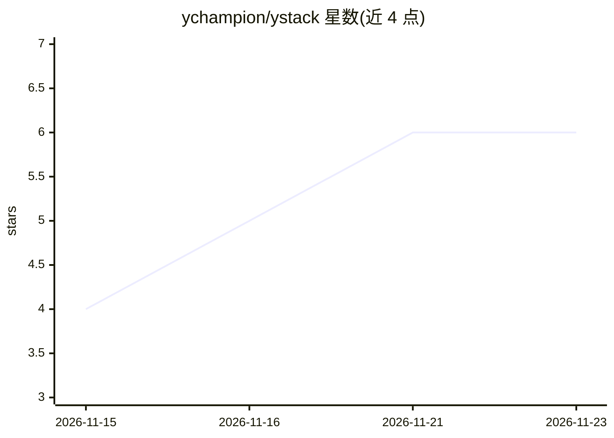

# ychampion/ystack

⭐ 6 · TypeScript · MIT · 推送 2026-11-19 · [GitHub](https://github.com/ychampion/ystack) · 个人维护

**为 Claude Code/Codex 等 agent 提供 mods/skills/守卫规则的增强工具集**

面向长时间运行编码 agent 的开发者的 mods、skills 与安装配置集合，覆盖 Claude Code、Codex、OpenCode、Antigravity 和 Devin 五种宿主。包含 37 个 mods（通过 hooks 在工具调用、提示与 subagent 回合上以代码方式执行规则，如 push-guard、verify、package-bouncer）与 51 个 skills，另提供 context-meter、model-router 等用于长会话与用量控制。通过插件市场一行安装或 git clone 源码 setup 安装，支持自动更新与卸载。README 明确标注为 0.1 早期版本，预期频繁变更。

## 筛选速览

| 维度 | 判定 | 备注 |
|---|---|---|
| AI 角色 | `ai-ecosystem` | LLM/agent 周边工具 |
| 许可风险 | `permissive` | MIT |
| 部署形态 | `None` |  |
| 模型依赖 | — | README 未给出锁定关系 |
| 硬件要求 | — | 无带数字的原话,不猜 |
| 安装摩擦 | `low` | 无编译、无系统依赖或容器化 |
| 成熟度 | `idea` | |

## 能力要点

- 37 个独立 mods，经 hooks 将规则以代码强制执行而非仅靠提示
- 51 个 skills 跨 Claude Code、Codex、OpenCode、Antigravity、Devin 共用
- 一行命令安装，自带自动更新与 --uninstall 清理
- 基于约 24.8 万次 API 调用日志的用量统计报告

## 适用场景

- 为 Claude Code 长会话加装推送守卫与完成校验规则
- 控制编码 agent 的上下文与 token 用量开销
- 在同一套 skills 下切换多种编码 agent 宿主

## 场景标签

`提示工程` · 领域:Agent 开发

## 证据(README 行号)

> L3: ystack is a collection of mods, skills, and setup tools for Claude Code, Codex, OpenCode, Antigravity and Devin. It 
> L121: Most agent stacks provide skills: written advice the model may or may not follow. ystack also has mods, which use 

## 星数曲线

2026-11-15 4 → 2026-11-23 6（+2）

---
*卡片 v1 · prompt 1.4 · 生成 2026-11-21 · 置信度 high · 依据 README sha `7630c17da8de` · [字段定义](../../DATASET.md)*
