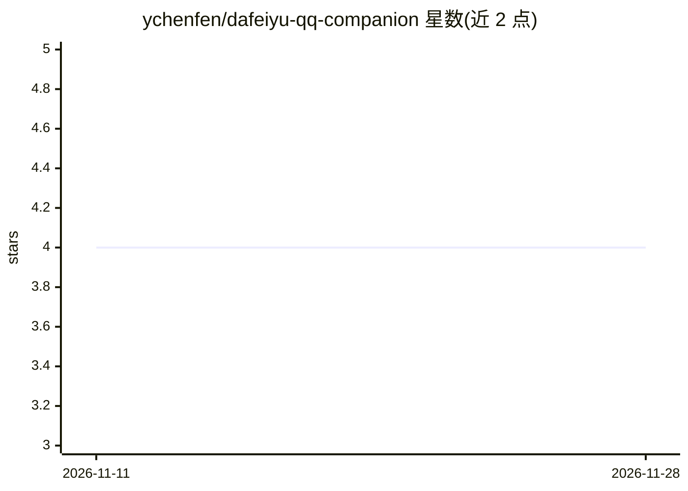

# ychenfen/dafeiyu-qq-companion

⭐ 4 · Python · NOASSERTION · 推送 2026-11-08 · [GitHub](https://github.com/ychenfen/dafeiyu-qq-companion) · 个人维护 · 中文 README

**在 QQ 里部署 AI 恋人角色扮演机器人的提示词架构与插件工程**

仓库提供一套 AI 伴侣角色的分层提示词架构与完整部署实现：L0 基础人设、L1 去 AI 味规则、L2 按需加载的五个玩法模式包，宣称通过按需热插拔较全量注入节省约 78.8% Token。QQ 部署链路由 NapCat（OneBot v11 接口）、AstrBot 机器人框架和自研插件组成，插件提供签名修改核验、SQLite 长期记忆、定时主动消息与群聊隔离。不部署 QQ 时可导入预编译的 SillyTavern V2 角色卡与世界书，或用 CLI 编译单文件 Prompt。

## 筛选速览

| 维度 | 判定 | 备注 |
|---|---|---|
| AI 角色 | `ai-native` | 本体是模型或模型工具 |
| 许可风险 | `permissive` | NOASSERTION |
| 部署形态 | `self-host` | docker 或自建部署 |
| 模型依赖 | — | README 未给出锁定关系 |
| 硬件要求 | — | 无带数字的原话,不猜 |
| 安装摩擦 | `low` | 无编译、无系统依赖或容器化 |
| 成熟度 | — | 结构信号不足 |

## 能力要点

- L0/L1/L2 三层动态热插拔提示词栈，按口令加载/卸载玩法包
- 预生成 SillyTavern V2 角色卡与关键词触发世界书，可直接导入
- NapCat+AstrBot 插件：签名改后读回核验、SQLite 独立记忆、定时主动开口、群聊/私聊隔离
- docker compose 一键部署，附单元测试与踩坑记录

## 适用场景

- 在 QQ 私聊里运行一个带记忆和主动消息的 AI 伴侣角色
- 把提示词导入 SillyTavern 直接对话使用
- 参考其分层提示词工程方法压缩自己的角色扮演 Prompt

## 场景标签

`聊天机器人` `Agent 记忆` `提示工程` · 领域:Agent 开发

## 证据(README 行号)

> L1: # 大肥鱼 · 在 QQ 里养一个电子恋人（主打：三层热插拔去 AI 味提示词工程）
> L3: > **一套真正有“活人感”的 AI 伴侣提示词架构与完整 QQ 工程实现**：**L0/L1/L2 三层动态提示词栈（省 78.8% Token）** + **五种典型 AI 味猎杀协议** + **【一句话就翻面】双态句法状态机
> L99: QQ 手机 ──> 腾讯服务器 ──> NapCat（登录小号，OneBot v11）

## 星数曲线

2026-11-11 4 → 2026-11-28 4（+0）

---
*卡片 v1 · prompt 1.4 · 生成 2026-11-21 · 置信度 high · 依据 README sha `fc9e6705c2ad` · [字段定义](../../DATASET.md)*
