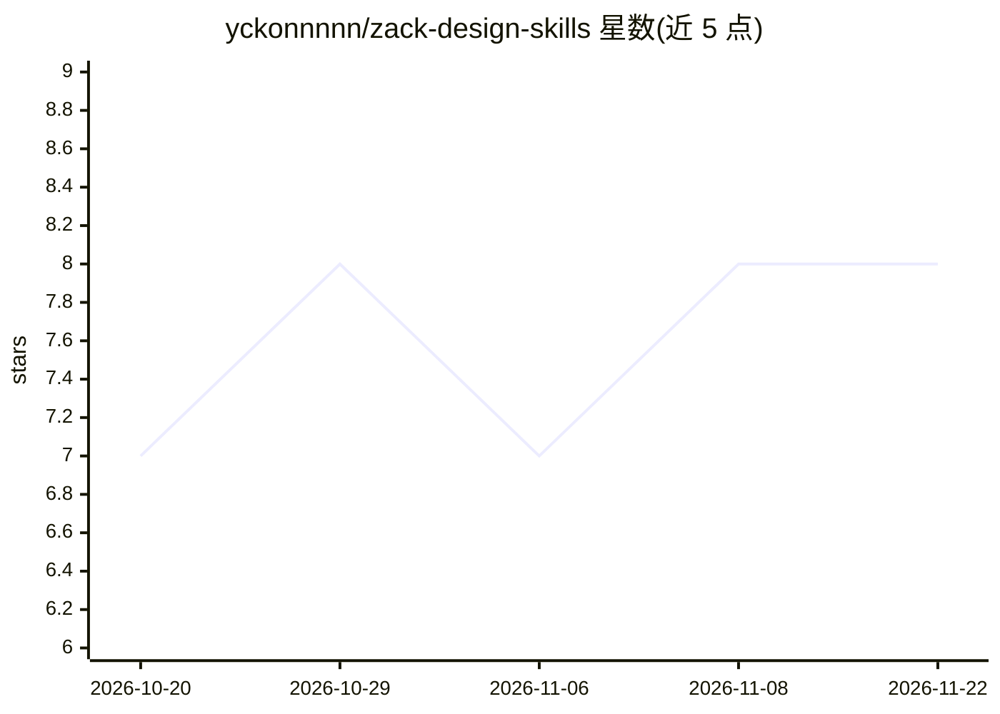

# yckonnnnn/zack-design-skills

⭐ 8 · Python · MIT · 推送 2026-11-21 · [GitHub](https://github.com/yckonnnnn/zack-design-skills) · [官网](https://yckonnnnn.github.io/zack-design-skills/) · 个人维护 · 中文 README

**给 AI 编码工具用的网页设计技能包，修掉 AI 味**

8 个纯 Markdown 技能与 60 条可执行判断标准，安装到 Claude Code / Cursor / Codex 等工具的 skills 目录后，用提示词驱动：对现有网页做 AI 味诊断（P0/P1/P2 分级）、新建落地页、还原 Figma 稿、执行改版审计。技能含路由总入口、排版配色、间距节奏、动效、Figma MCP 取数等，不需要 API key、联网或依赖。提供改前改后在线对比页。仅适用于落地页/官网类场景，不覆盖后台表格与原生 App。

## 筛选速览

| 维度 | 判定 | 备注 |
|---|---|---|
| AI 角色 | `ai-knowledge` | 知识聚合/清单类 |
| 许可风险 | `permissive` | MIT |
| 部署形态 | `None` |  |
| 模型依赖 | — | README 未给出锁定关系 |
| 硬件要求 | — | 无带数字的原话,不猜 |
| 安装摩擦 | `low` | 无编译、无系统依赖或容器化 |
| 成熟度 | — | 结构信号不足 |

## 能力要点

- 8 个技能 + 60 条带具体数字阈值的判断标准
- zack-anti-ai-look 提供分级诊断清单与修复优先级
- 纯 Markdown，无需构建、依赖、API key 或联网
- 提供改前/改后对比页与 21 处改动对照表

## 适用场景

- 让 Claude Code 扫描我的网站，出一张 AI 味诊断表
- 帮我把 Figma 设计稿还原成前端组件
- 给我的 SaaS 做官网落地页和定价页
- 对老官网做改版审计并最小化修复

## 场景标签

`提示工程` · 领域:Agent 开发

## 证据(README 行号)

> L10: > 一套给 AI 编码工具用的设计技能包。8 个技能，60 条可执行的判断标准，专治「一眼就能看出是 AI 做的」。
> L31: 这套技能做的事情，就是把这个平均值拆成 60 条可以逐条检查、逐条修掉的规则。
> L178: 不需要。纯 Markdown，不需要 API key、不需要联网、不需要装依赖。`zack-figma-to-code` 需要你已经在用 Figma MCP，但那只影响这一个技能。

## 星数曲线

2026-10-20 7 → 2026-11-22 8（+1）

---
*卡片 v1 · prompt 1.4 · 生成 2026-11-20 · 置信度 high · 依据 README sha `86d231217a4e` · [字段定义](../../DATASET.md)*
