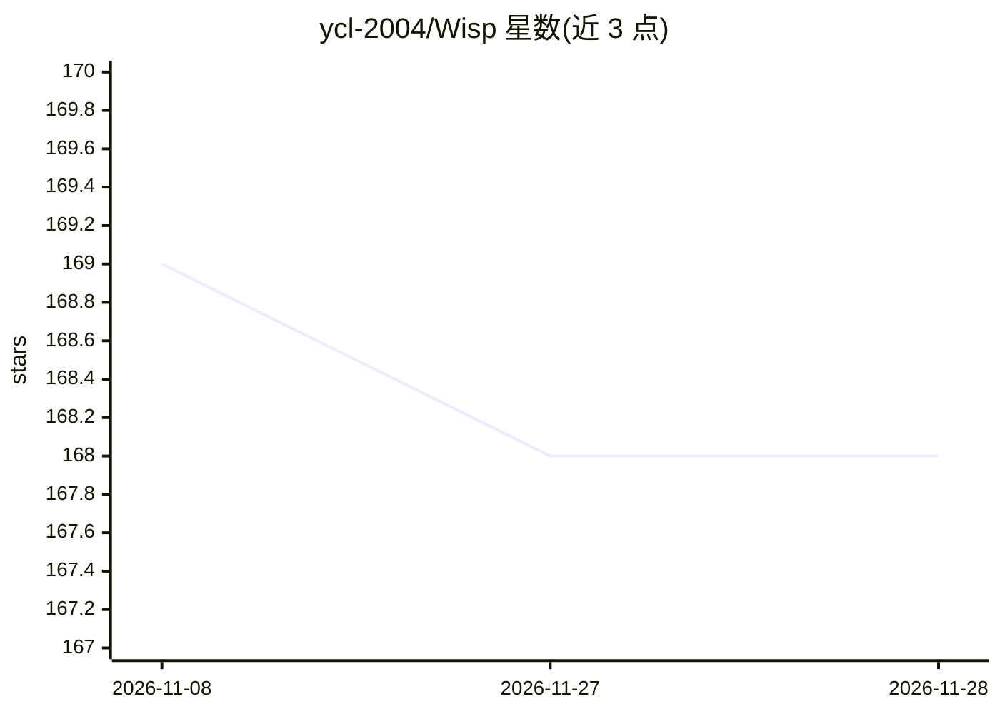

# ycl-2004/Wisp

⭐ 168 · Swift · MIT · 推送 2026-11-27 · [GitHub](https://github.com/ycl-2004/Wisp) · 个人维护 · 中文 README

**读取屏幕与浏览器上下文的 macOS 菜单栏 AI 问答助手**

常驻 macOS 菜单栏的本地优先桌面应用：按快捷键捕获前台应用窗口或整屏截图，在支持的浏览器中读取 URL、标题、选中文本与页面正文，将其作为上下文发给用户配置的模型端点并流式返回回答。另提供会议实时字幕（仅收听系统音频）、字幕快捷提问、hold-to-ask 语音提问，以及屏幕共享时隐藏自身的虚拟显示器方案。提供英文与简体中文界面，Universal 2 构建，MIT 许可，发布版未经 Apple 公证。

## 筛选速览

| 维度 | 判定 | 备注 |
|---|---|---|
| AI 角色 | `ai-native` | 本体是模型或模型工具 |
| 许可风险 | `permissive` | MIT |
| 部署形态 | `desktop` | 安装包/桌面程序 |
| 模型依赖 | local-ok | 支持本地模型 |
| 硬件要求 | — | 无带数字的原话,不猜 |
| 安装摩擦 | `medium` | 含编译或系统依赖之一 |
| 成熟度 | `idea` | |

## 能力要点

- 捕获前台窗口/整屏截图与浏览器页面文本作为问答上下文
- 三种模型接入：OpenAI 兼容端点、Ollama 本地服务、Agent CLI（Codex/Antigravity/Claude Code）
- 会议实时字幕配合 Quick Ask / Ask About Screen 快捷键提问
- 屏幕共享隐藏（虚拟显示器与 sharingType 两种机制，并声明 OS 级局限）

## 适用场景

- 阅读网页或写代码时直接就当前屏幕内容提问，不用手动复制上下文
- 开会议时看实时字幕并就对方刚说的话快速提问
- 本地运行 Ollama 模型，避免页面内容发送到云端
- 共享屏幕开会时隐藏助手面板窗口

## 场景标签

`AI 助手` · 领域:对话与助手

## 证据(README 行号)

> L5:  A native macOS AI assistant that reads your current screen and browser context when you ask.
> L31: It is a local-first desktop shell around the model provider you choose:
> L216: - **Cloud endpoint:** sends `chat/completions` requests with SSE streaming and

## 星数曲线

2026-11-08 169 → 2026-11-28 168（-1）

---
*卡片 v1 · prompt 1.4 · 生成 2026-11-28 · 置信度 high · 依据 README sha `965a35aa52f6` · [字段定义](../../DATASET.md)*
