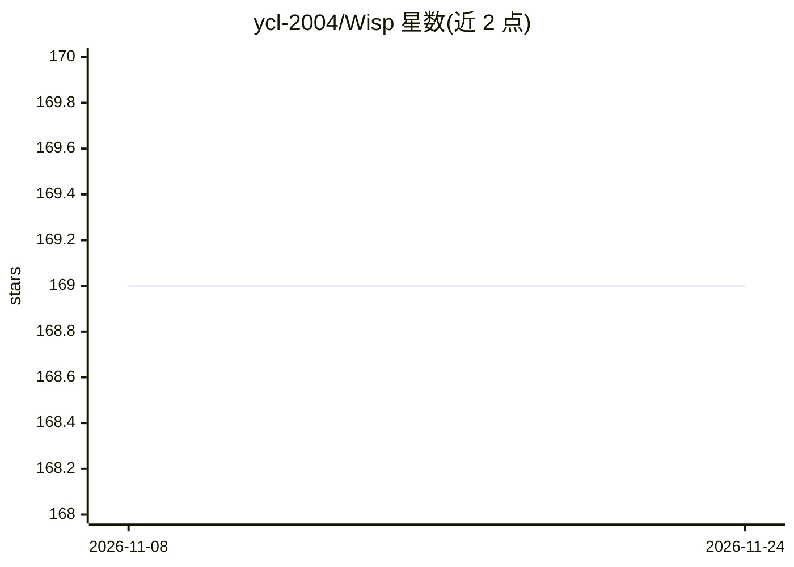

# ycl-2004/Wisp

⭐ 169 · Swift · MIT · 推送 2026-11-20 · [GitHub](https://github.com/ycl-2004/Wisp) · 个人维护 · 中文 README

**macOS 菜单栏 AI 助手：读屏与浏览器上下文回答问题**

用 SwiftUI/AppKit 构建的本地优先 macOS 菜单栏应用：快捷键唤出面板后捕获当前窗口或全屏截图，并读取支持浏览器的 URL、标题、选中文本与页面正文，作为提问上下文发送给用户选择的模型（OpenAI 兼容 HTTP、Ollama 或 Agent CLI 如 Codex/Claude Code）。支持多浏览器（Chrome/Safari/Edge 等）、语音听写（Apple Speech 或本地 sherpa-onnx 模型如 SenseVoice、Qwen3-ASR）、屏幕共享隐藏（实验性）。会话与页面快照存储在本机；使用云服务商时页面全文与截图会发送至所配置端点。要求 macOS 14.0+，发布版未公证。

## 筛选速览

| 维度 | 判定 | 备注 |
|---|---|---|
| AI 角色 | `ai-native` | 本体是模型或模型工具 |
| 许可风险 | `permissive` | MIT |
| 部署形态 | `desktop` | 安装包/桌面程序 |
| 模型依赖 | local-ok | 支持本地模型 |
| 硬件要求 | — | 无带数字的原话,不猜 |
| 安装摩擦 | `medium` | 含编译或系统依赖之一 |
| 成熟度 | — | 结构信号不足 |

## 能力要点

- 按需捕获当前窗口/全屏截图并读取浏览器 URL、标题、选中文本与页面正文
- 模型连接可选：OpenAI 兼容 HTTP、Ollama、Agent CLI（Codex/Antigravity/Claude Code）
- 语音听写支持 Apple Speech 与本地 sherpa-onnx 模型（SenseVoice、Qwen3-ASR）
- 会话文本与页面快照本地存储，显式删除而非自动清理

## 适用场景

- 不切换应用、不复制粘贴，直接就当前屏幕内容向 AI 提问
- 阅读网页时结合页面正文与截图让 AI 解答
- 会议结束后一键把语音转写发给 AI 分析

## 场景标签

`AI 助手` · 领域:对话与助手

## 证据(README 行号)

> L5:  A native macOS AI assistant that reads your current screen and browser context when you ask.
> L31: It is a local-first desktop shell around the model provider you choose:

## 星数曲线

2026-11-08 169 → 2026-11-24 169（+0）

---
*卡片 v1 · prompt 1.4 · 生成 2026-11-17 · 置信度 high · 依据 README sha `34d169a84bc6` · [字段定义](../../DATASET.md)*
