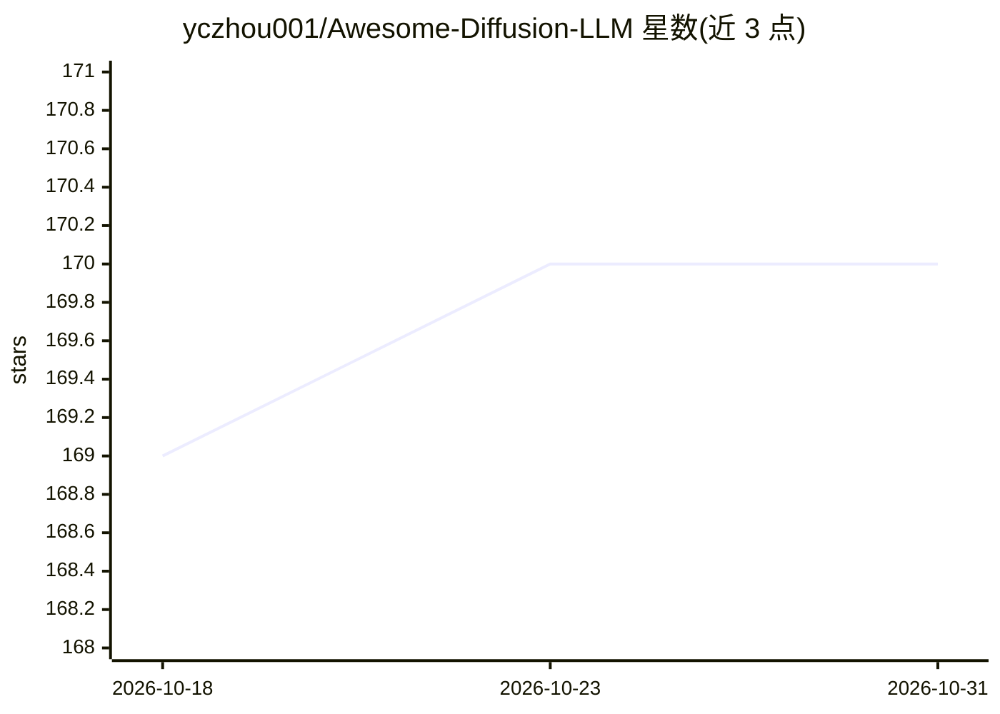

# yczhou001/Awesome-Diffusion-LLM

⭐ 170 · Jupyter Notebook · 推送 2026-01-19 · [GitHub](https://github.com/yczhou001/Awesome-Diffusion-LLM) · 个人维护

**扩散语言模型（Diffusion LLM）论文清单与教程代码库**

面向科研与开发者的 Diffusion LLM 主题资源库：持续更新的论文列表，按多模态理解、离散扩散、连续时间扩散、应用等类别组织，覆盖 NeurIPS/ICLR/ACL 等会议与 arXiv 论文，部分条目附代码链接；提供两份 Jupyter notebook 教学代码，分别演示连续空间扩散语言模型与基于掩码的离散扩散语言模型（实现参考 LLaDA 的 GUIDELINES.md）；另列出 Dream7B、LLaDA8B 等可体验的 Playground 入口。

## 筛选速览

| 维度 | 判定 | 备注 |
|---|---|---|
| AI 角色 | `ai-knowledge` | 知识聚合/清单类 |
| 许可风险 | `permissive` | — |
| 部署形态 | `None` |  |
| 模型依赖 | — | README 未给出锁定关系 |
| 硬件要求 | — | 无带数字的原话,不猜 |
| 安装摩擦 | `low` | 无编译、无系统依赖或容器化 |
| 成熟度 | — | 结构信号不足 |

## 能力要点

- 按多模态/离散/连续时间/应用等类别组织的扩散语言模型论文清单
- 两份 Jupyter notebook：连续扩散与掩码离散扩散语言模型的入门实现
- 收录 Gemini Diffusion、Mercury、Dream7B 等产品与技术报告条目

## 适用场景

- 系统查阅扩散语言模型的论文与代码资源
- 通过 nano 代码理解连续/离散扩散语言模型的建模与采样原理
- 了解扩散 LLM 的产品与技术报告动态

## 场景标签

`科研工具` `教程课程` `精选清单` · 领域:学习与行业

## 证据(README 行号)

> L7:  - A regularly updated paper list for Diffusion Large Language Models.
> L8:  - A tutorial for Diffusion Large Language Models.
> L9:  - A nano code snippet for Diffusion Large Language Models.

## 星数曲线

2026-10-18 169 → 2026-10-31 170（+1）

---
*卡片 v1 · prompt 1.4 · 生成 2026-10-23 · 置信度 high · 依据 README sha `aa4e2800c0e4` · [字段定义](../../DATASET.md)*
