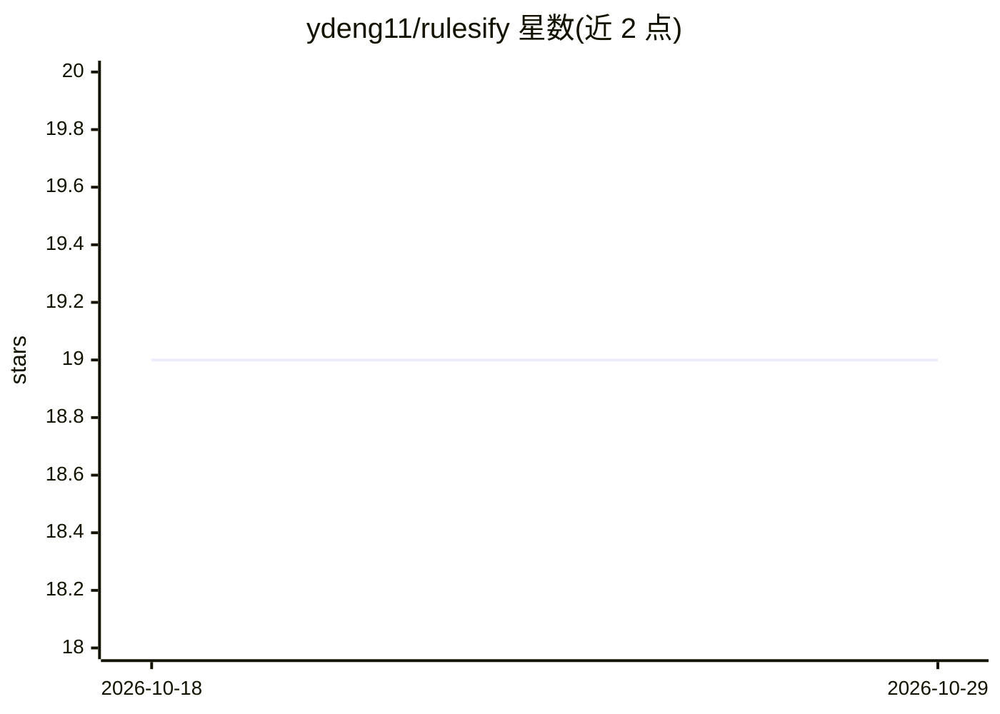

# ydeng11/rulesify

⭐ 19 · Rust · MIT · 推送 2026-09-20 · [GitHub](https://github.com/ydeng11/rulesify) · 个人维护

**AI agent 技能管理 CLI：从策展仓库发现并安装预置技能**

用 Rust 编写的命令行技能管理工具：从 anthropics/skills、openai/skills、mattpocock/skills、MiniMax-AI/skills 四个 GitHub 仓库策展 50+ 个技能（预置工作流与方法论模块），经 LLM 自动分类到 10 个领域并提供标签检索；支持项目级与全局安装，可同时安装到 Claude Code、Codex、Cursor 等多种 AI 工具，配置与磁盘状态自动对账。技能注册表经 GitHub Actions 每周更新，更新过程需 GitHub 与 OpenRouter token。提供 Homebrew、一键脚本与手动二进制三种安装方式。

## 筛选速览

| 维度 | 判定 | 备注 |
|---|---|---|
| AI 角色 | `ai-ecosystem` | LLM/agent 周边工具 |
| 许可风险 | `permissive` | MIT |
| 部署形态 | `None` |  |
| 模型依赖 | — | README 未给出锁定关系 |
| 硬件要求 | — | 无带数字的原话,不猜 |
| 安装摩擦 | `low` | 无编译、无系统依赖或容器化 |
| 成熟度 | — | 结构信号不足 |

## 能力要点

- 从 Anthropic/OpenAI/社区仓库策展 50+ 技能
- LLM 自动分类到 10 个领域，支持领域过滤与标签搜索
- 一次安装到多个 AI 工具（Claude Code、Codex、Cursor 等）
- 配置与磁盘状态自动对账（手动删除技能后同步清理）

## 适用场景

- 为 Claude Code/Codex/Cursor 等 AI 工具批量查找并安装技能
- 按开发、测试、设计等领域浏览预置工作流
- 统一更新与移除项目或全局安装的技能

## 场景标签

 · 领域:AI 工具链/技能管理

## 证据(README 行号)

> L3: Rulesify is a **skill management tool for AI agents**. Discover, browse, and install pre-built skills from curated G
> L25: - **Multi-Tool Support**: Install to multiple AI tools simultaneously (Claude Code, Codex, Cursor, etc.)

## 星数曲线

2026-10-18 19 → 2026-10-29 19（+0）

---
*卡片 v1 · prompt 1.4 · 生成 2026-10-28 · 置信度 high · 依据 README sha `f519dacafa49` · [字段定义](../../DATASET.md)*
