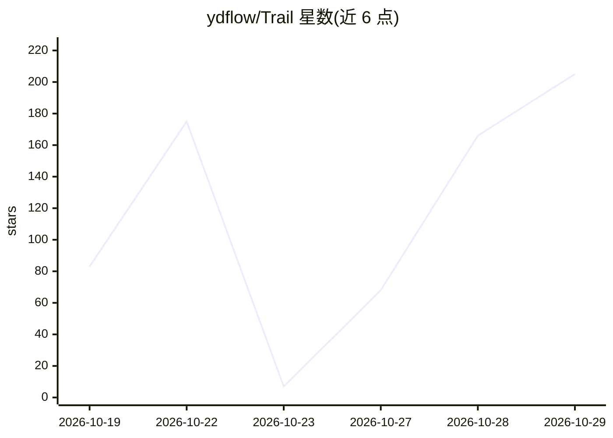

# ydflow/Trail

⭐ 205 · TypeScript · 推送 2026-10-24 · [GitHub](https://github.com/ydflow/Trail) · [官网](https://github.com/ydflow/Trail#readme) · 组织维护 · 中文 README

**本地优先的 AI 投资研究桌面工作台，含证据链与持续复核**

Electron + React/TypeScript 桌面应用，面向需反复研究公开市场标的的个人投资者，也为 Agent 应用开发者提供可检查的工程实现。以证券为中心组织 K 线、深度研究（8 种策略、可恢复 checkpoint）、上下文感知的 AI 副驾驶（Pi runtime、流式输出）、来源检查器（数值/提供商/快照哈希）、17 个确定性筛选任务与内置评测中心（86 案例基准集）。行情依赖长桥 CLI 授权，模型需自行配置（如 DeepSeek）；当前为 Beta，仅提供 Windows x64 安装版，未签名且不做下单交易。

## 筛选速览

| 维度 | 判定 | 备注 |
|---|---|---|
| AI 角色 | `ai-native` | 本体是模型或模型工具 |
| 许可风险 | `none` | — |
| 部署形态 | `desktop` | 安装包/桌面程序 |
| 模型依赖 | locked-api |  |
| 硬件要求 | — | 无带数字的原话,不猜 |
| 安装摩擦 | `low` | 无编译、无系统依赖或容器化 |
| 成熟度 | `idea` | |

## 能力要点

- 8 种深度研究策略与可恢复 checkpoint 机制
- 引用可定位到工具来源，来源检查器展示数值、提供商与快照哈希
- 17 个确定性筛选任务与含 86 个案例的评测基准集
- SKILL.md 技能包按需加载，支持 Langfuse/LangSmith 可选追踪

## 适用场景

- 围绕证券展开带证据链的深度研究并保存为投资逻辑持续复核
- 在本地工作台查看行情 K 线并让 AI 助手结合上下文解释
- 通过确定性筛选任务从自选中发现并跟进研究线索

## 场景标签

`金融量化` · 领域:学习与行业

## 证据(README 行号)

> L7:  本地优先的 AI 投资研究桌面工作台，连接行情、图表、Agent、证据与持续复核。
> L21: **研迹把这条工作链放回同一个桌面：发现线索 → 查看证券 → 发起研究 → 核验证据 → 保存投资逻辑 → 持续复核。** 面向需要反复研究公开市场标的的个人投资者，也为 Agent 应用开发者提供一套可检查的桌面工程实现。
> L33: 以证券为中心展开 K 线、研究依据和判断侧栏；报告完成后可以查看分项结论、风险、催化剂，并继续保存为投资逻辑。

## 星数曲线

2026-10-19 83 → 2026-10-29 205（+122）

---
*卡片 v1 · prompt 1.4 · 生成 2026-10-22 · 置信度 high · 依据 README sha `64c419de7d11` · [字段定义](../../DATASET.md)*
