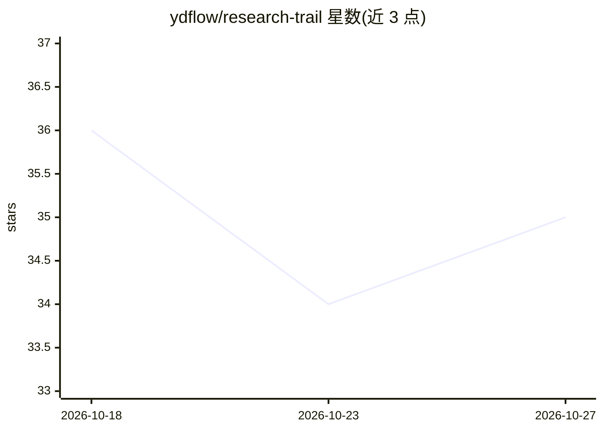

# ydflow/research-trail

⭐ 35 · Python · 推送 2026-10-16 · [GitHub](https://github.com/ydflow/research-trail) · [官网](https://github.com/ydflow/research-trail/releases/tag/v1.0.0) · 组织维护 · 中文 README

**给个人投资研究者的本地 AI 研究工作台，研究有据、判断留痕**

面向个人投资研究者的本地桌面工作台（Electron + Python 业务内核，数据落本机）。功能覆盖：围绕证券的八种策略研究采集与报告合成（事实/分析/预测分层、引用可回源、Markdown 导出）、组合导入与确定性风险计算、17 个固定筛选任务、Today 有来源简报与事件日历、投资论点多空依据与复审、以及 Agent 离线评测中心（案例、工具轨迹、失败分类、模型 A/B、Brier 校准统计）。不提供交易下单；模拟模式默认可用，真实服务按配置接入。Windows 提供 v1.0.0 安装包，也可从源码启动。

## 筛选速览

| 维度 | 判定 | 备注 |
|---|---|---|
| AI 角色 | `ai-native` | 本体是模型或模型工具 |
| 许可风险 | `none` | — |
| 部署形态 | `None` |  |
| 模型依赖 | — | README 未给出锁定关系 |
| 硬件要求 | — | 无带数字的原话,不猜 |
| 安装摩擦 | `low` | 无编译、无系统依赖或容器化 |
| 成熟度 | — | 结构信号不足 |

## 能力要点

- 研究报告将事实/分析/预测分层，引用回到原始执行结果，可导出 Markdown
- 评测中心：确定性离线案例、工具轨迹、失败分类、同一冻结数据的模型 A/B
- 论点保存多空依据与版本，复审保留变化理由；投资结果页含 Brier 与分箱校准
- 组合风险与筛选由 Python 确定性计算，缺失指标保留原因不补成事实

## 适用场景

- 围绕一只证券持续采集资料、生成有引用的研究报告
- 保存投资论点的多空依据，用新资料复审并留痕
- 用离线案例与模型 A/B 检查 Agent 研究是否可靠
- 每天从 Today 简报查看组合、事件与待复审论点

## 场景标签

`金融量化` `模型评测` `科研工具` · 领域:评测与运维

## 证据(README 行号)

> L6:  面向个人投资研究者的本地 AI 研究工作台
> L13: 研迹把证券资料、投资组合、研究会话、证据报告与后续复审放进同一个桌面工作区。你可以围绕一只证券持续研究，也可以从自己的组合和今日事项出发，逐步形成可回溯的判断。
> L111: React 页面通过受限的桌面桥访问 Python；研究采集与只读工具保留原始结果。规则演示、固定报告和模拟行情默认可用，真实服务按配置与权限明确呈现状态。应用不提供交易下单。

## 星数曲线

2026-10-18 36 → 2026-10-27 35（-1）

---
*卡片 v1 · prompt 1.4 · 生成 2026-10-25 · 置信度 high · 依据 README sha `fdb6caa8e6c0` · [字段定义](../../DATASET.md)*
