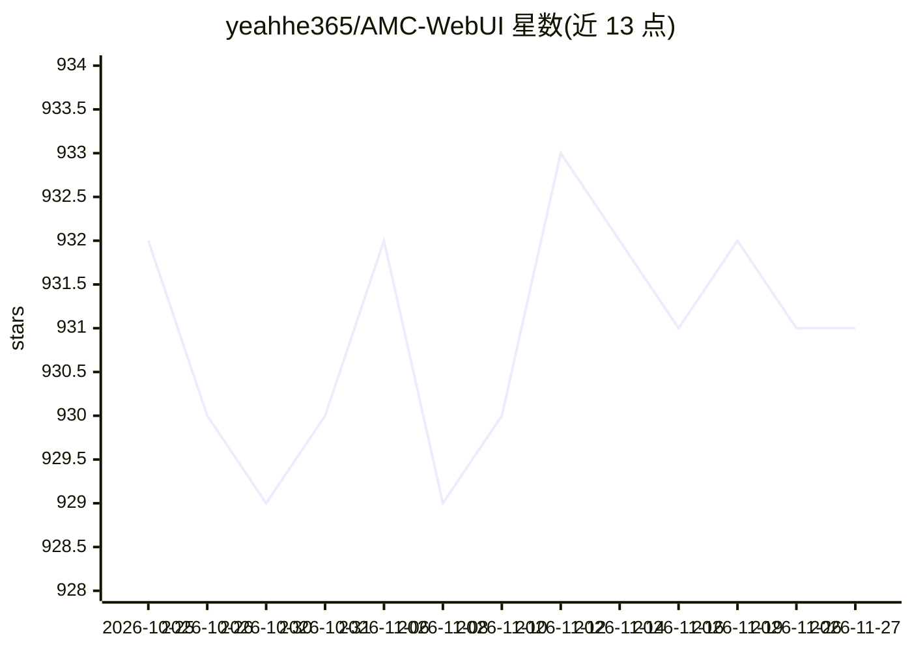

# yeahhe365/AMC-WebUI

⭐ 931 · TypeScript · MIT · 推送 2026-11-23 · [GitHub](https://github.com/yeahhe365/AMC-WebUI) · [官网](https://all-model-chat.pages.dev/) · 个人维护 · 中文 README

**面向 Gemini 用户的本地优先多模态 AI 聊天 WebUI**

AMC WebUI 是一款基于 React 18 + Vite 的 Web 界面，主打 Google Gemini 原生能力，并提供独立的 OpenAI 兼容聊天模式。提供深度推理可视化、Live API 实时音视频、深度搜索、浏览器端 Python 沙箱、TTS、语音转录与图片生成等功能。聊天数据默认存于浏览器 IndexedDB（Local-First），同时支持 Docker 双容器部署或静态前端加独立 Node API 托管 Gemini 密钥与代理请求。README 标明该代理方案定位为受信任自托管环境，公开开放需自行补充鉴权与限流。

## 筛选速览

| 维度 | 判定 | 备注 |
|---|---|---|
| AI 角色 | `ai-native` | 本体是模型或模型工具 |
| 许可风险 | `permissive` | MIT |
| 部署形态 | `self-host` | docker 或自建部署 |
| 模型依赖 | — | README 未给出锁定关系 |
| 硬件要求 | — | 无带数字的原话,不猜 |
| 安装摩擦 | `low` | 无编译、无系统依赖或容器化 |
| 成熟度 | — | 结构信号不足 |

## 能力要点

- Gemini 原生能力：Thinking 可视化、Live API 音视频、Deep Search、图片生成、TTS 与转录
- 基于 Pyodide (WASM) 的浏览器端 Python 沙箱，按需加载 numpy/pandas 等包
- 支持 MCP 三种传输协议与工具调用前弹窗授权机制
- Gemini 原生与 OpenAI 兼容双模式，均支持多 Key 轮询

## 适用场景

- 在浏览器里与 Gemini 进行多模态聊天、语音通话与屏幕共享
- 自托管部署并代理管理 Gemini API Key
- 通过浏览器端 Python 沙箱执行数据处理代码
- 配置 OpenAI 兼容服务商进行标准聊天

## 场景标签

`聊天机器人` `图像生成` `语音合成` `多模态` · 领域:对话与助手

## 证据(README 行号)

> L33: **AMC WebUI** 是一款基于 React 18 的 All-in-one Model Console WebUI，主打 Google Gemini 原生能力，并提供额外的 **OpenAI 兼容标准聊天模式**。项目坚持
> L49: - 项目的主能力路径，适用于 Thinking、Live API、Gemini Files API、Deep Search、Google Search、代码执行、图片生成等 Gemini 专属能力
> L97: - **本地 Python 沙箱**：基于 Pyodide (WASM) 的浏览器端 Python 运行环境

## 星数曲线

2026-10-25 932 → 2026-11-27 931（-1）

---
*卡片 v1 · prompt 1.4 · 生成 2026-11-24 · 置信度 high · 依据 README sha `2f7ce7545966` · [字段定义](../../DATASET.md)*
