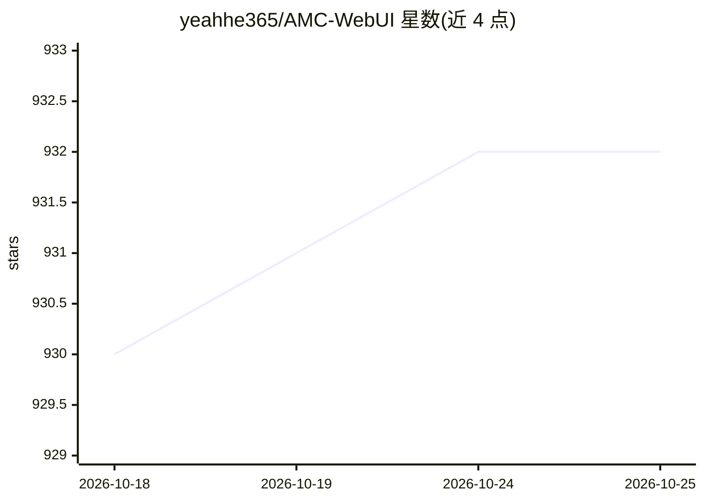

# yeahhe365/AMC-WebUI

⭐ 930 · TypeScript · MIT · 推送 2026-10-20 · [GitHub](https://github.com/yeahhe365/AMC-WebUI) · [官网](https://all-model-chat.pages.dev/) · 个人维护 · 中文 README

**主打 Gemini 原生能力的 Local-First 多模态聊天 WebUI**

基于 React 18 + Vite 的单页应用，面向自带 API Key 的个人用户，提供多模态聊天、思维链可视化、Live API 实时音视频、文件处理、深度搜索、Pyodide 本地 Python 沙箱、TTS/语音转录与图片生成等 Gemini 专属能力，另附 OpenAI 兼容标准聊天模式（独立 Key/Base URL/模型列表）。聊天数据默认存浏览器 IndexedDB，支持 Vite 本地开发、Docker 双容器部署与 Pages 静态部署三种形态。限制：web+api 代理定位为可信自托管环境，公网开放需自行加鉴权与限流。

## 筛选速览

| 维度 | 判定 | 备注 |
|---|---|---|
| AI 角色 | `ai-native` | 本体是模型或模型工具 |
| 许可风险 | `permissive` | MIT |
| 部署形态 | `self-host` | docker 或自建部署 |
| 模型依赖 | — | README 未给出锁定关系 |
| 硬件要求 | — | 无带数字的原话,不猜 |
| 安装摩擦 | `low` | 无编译、无系统依赖或容器化 |
| 成熟度 | — | 结构信号不足 |

## 能力要点

- Gemini 原生模式覆盖 Thinking、Live API、Deep Search、代码执行与图片生成
- OpenAI 兼容模式支持独立 Key、Base URL、模型列表与多 Key 轮询
- 聊天数据本地存 IndexedDB，支持 MCP 三种传输协议与人在回路授权
- 提供 Vite 开发、Docker Compose 与 Cloudflare Pages + 独立 API 三种部署方式

## 适用场景

- 用 Gemini API Key 自建多模态聊天界面并本地保存聊天记录
- 通过 OpenAI 兼容接口接入 DeepSeek、OpenRouter 等第三方模型聊天
- 在浏览器内做带实时音视频与本地 Python 沙箱的 AI 对话

## 场景标签

`聊天机器人` `图像生成` `语音合成` `多模态` · 领域:对话与助手

## 证据(README 行号)

> L33: **AMC WebUI** 是一款基于 React 18 的 All-in-one Model Console WebUI，主打 Google Gemini 原生能力，并提供额外的 **OpenAI 兼容标准聊天模式**。项目坚持
> L49: - 项目的主能力路径，适用于 Thinking、Live API、Gemini Files API、Deep Search、Google Search、代码执行、图片生成等 Gemini 专属能力

## 星数曲线

2026-10-18 930 → 2026-10-25 932（+2）

---
*卡片 v1 · prompt 1.4 · 生成 2026-10-21 · 置信度 mid · 依据 README sha `d8ea94f21a4a` · [字段定义](../../DATASET.md)*
