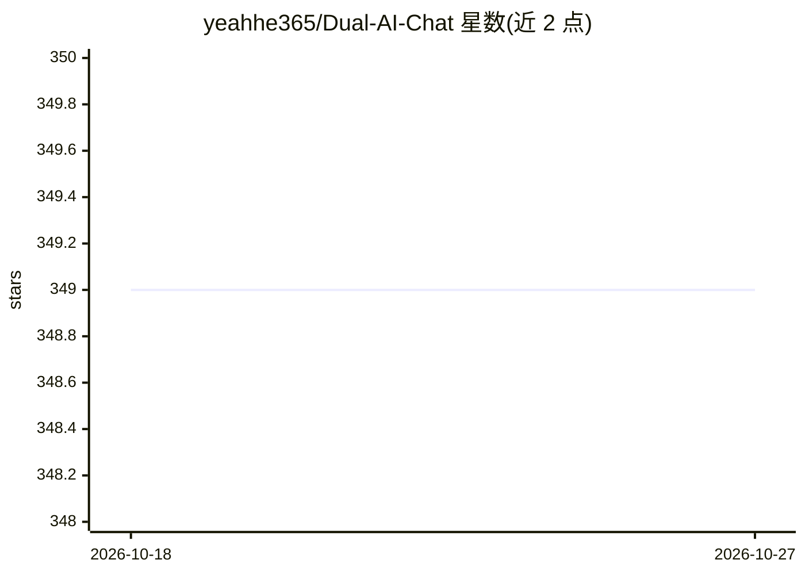

# yeahhe365/Dual-AI-Chat

⭐ 349 · TypeScript · MIT · 推送 2026-07-16 · [GitHub](https://github.com/yeahhe365/Dual-AI-Chat) · [官网](https://c3d98006.dual-ai-chat-dvb.pages.dev/) · 个人维护 · 中文 README

**双 AI 角色辩论后综合作答的 React 聊天应用**

基于 React 19 + TypeScript + Vite 构建的网页聊天应用：用户提问先由两个 AI 角色——Cognito（逻辑推理、事实核查、综合答案）与 Muse（横向思维、挑战假设）——内部辩论，再输出最终答案。集成 Google Gemini 官方 SDK，原生支持思考模型的 Token 预算与思考强度调节，也提供 OpenAI 兼容接口对接 DeepSeek、Ollama、LM Studio 等服务。附带 AI 共享记事本（Diff 视图、Markdown 编辑）、图片多模态输入。本地部署需 Node.js v18+，clone 后 npm install 并配置 API Key；也提供 Google AI Studio 与 Cloudflare Pages 在线入口。

## 筛选速览

| 维度 | 判定 | 备注 |
|---|---|---|
| AI 角色 | `ai-native` | 本体是模型或模型工具 |
| 许可风险 | `permissive` | MIT |
| 部署形态 | `library` | 以包/库形式分发 |
| 模型依赖 | local-ok | 支持本地模型 |
| 硬件要求 | — | 无带数字的原话,不猜 |
| 安装摩擦 | `low` | 无编译、无系统依赖或容器化 |
| 成熟度 | — | 结构信号不足 |

## 能力要点

- 双 AI 辩论机制：逻辑型 Cognito 与创意型 Muse 协作后综合作答
- 原生支持 Gemini 2.5/3.0 思考模型的 Token 预算与强度可视化调节
- Google Gemini 原生与 OpenAI 兼容接口双通道，可分别为两个 AI 指定不同模型
- AI 共享记事本作为长对话外部记忆，含 Diff 对比视图

## 适用场景

- 通过两个 AI 角色的辩论获得多角度审视后的回答
- 在设置中切换 Gemini 或本地 Ollama/DeepSeek 模型服务
- 利用共享记事本进行长对话与代码文本的协作修改

## 场景标签

`聊天机器人` · 领域:对话与助手

## 证据(README 行号)

> L14: **Dual AI Chat** 是一个基于 React 19 构建的下一代 AI 聊天应用。它引入了 **“协作智能”** 的概念，通过两个性格迥异的 AI 代理——**Cognito (逻辑)** 和 **Muse (创意)*
> L28: 用户的一个问题，会触发两个 AI 的即时协作：
> L29: * **Cognito (逻辑引擎):** 负责事实核查、逻辑推理、结构化分析和最终答案的综合。

## 星数曲线

2026-10-18 349 → 2026-10-27 349（+0）

---
*卡片 v1 · prompt 1.4 · 生成 2026-10-21 · 置信度 high · 依据 README sha `047b3c282575` · [字段定义](../../DATASET.md)*
