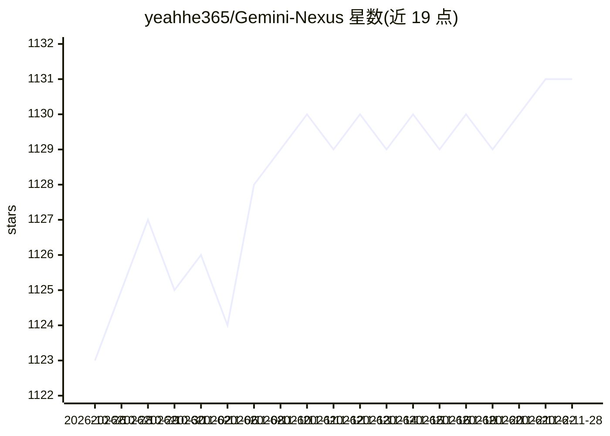

# yeahhe365/Gemini-Nexus

⭐ 1,131 · JavaScript · MIT · 推送 2026-11-13 · [GitHub](https://github.com/yeahhe365/Gemini-Nexus) · 个人维护 · 中文 README

**给浏览器接入多模型 AI 助手的 Chrome 扩展**

一款 Chrome 扩展，将 Gemini Web（逆向接口）、Gemini API、OpenAI 兼容 API 及 DeepSeek、OpenRouter、Anthropic、通义/DashScope、智谱等第三方 API 聚合为统一的浏览器 AI 层。提供侧边栏对话、划词工具栏、图像与截图输入（含 OCR 翻译）、基于 Chrome DevTools Protocol 的浏览器控制工具循环，以及通过 SSE/HTTP/WebSocket 接入外部 MCP 服务器。安装方式为下载 Release ZIP 加载解包目录，或从源码 npm 构建打包。README 明确披露 Gemini Web 逆向访问可能违反 Google 服务条款，需用户自担风险。

## 筛选速览

| 维度 | 判定 | 备注 |
|---|---|---|
| AI 角色 | `ai-native` | 本体是模型或模型工具 |
| 许可风险 | `permissive` | MIT |
| 部署形态 | `library` | 以包/库形式分发 |
| 模型依赖 | locked-api |  |
| 硬件要求 | — | 无带数字的原话,不猜 |
| 安装摩擦 | `low` | 无编译、无系统依赖或容器化 |
| 成熟度 | — | 结构信号不足 |

## 能力要点

- 聚合 9 类提供商驱动，按提供商配置 Base URL、API Key 与模型 ID
- 基于 Chrome DevTools Protocol 的浏览器控制工具（导航/交互/观察/脚本执行）
- 支持外部 MCP 服务器接入（SSE、streamable HTTP、WebSocket）
- 图像与截图输入，含 Canvas 裁剪 OCR 翻译与窗口捕获

## 适用场景

- 在浏览器侧边栏与多个模型对话并搜索网页资料
- 让 AI 通过工具循环代为执行网页点击、填表等操作
- 选中网页文本进行翻译、总结、语法修正
- 截图或页面图片区域进行 OCR 识别与翻译

## 场景标签

`浏览器自动化` `AI 助手` `OCR` · 领域:效率与自动化

## 证据(README 行号)

> L23: **Gemini Nexus** gives your browser a native AI layer by combining Gemini Web, the Google Gemini API, OpenAI-compat
> L39: - Switch among **Gemini Web**, **Gemini API**, **OpenAI Compatible API**, **OpenAI Official API**, **DeepSeek API**
> L68: Built on `background/control/` and Chrome DevTools Protocol, Gemini Nexus lets AI perform agentic browser tasks thr

## 星数曲线

2026-10-26 1,123 → 2026-11-28 1,131（+8）

---
*卡片 v1 · prompt 1.4 · 生成 2026-11-24 · 置信度 high · 依据 README sha `d35d22267fe9` · [字段定义](../../DATASET.md)*
