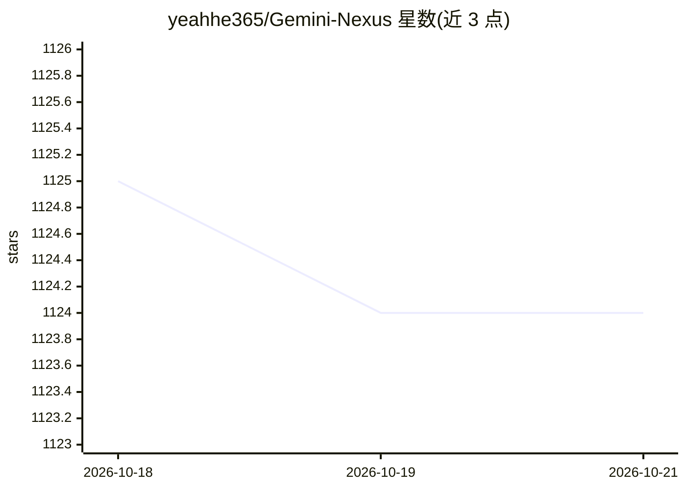

# yeahhe365/Gemini-Nexus

⭐ — · [GitHub]() · 个人维护 · 中文 README

**浏览器 AI 助手扩展：多模型对话与浏览器自动化控制**

Chrome 扩展（Manifest V3、TypeScript/Vite），把 Gemini Web（逆向 RPC 接入）、Gemini API、OpenAI 兼容接口及 DeepSeek、OpenRouter、Qwen/DashScope、Anthropic、智谱等 provider 汇集在侧边栏，支持网页上下文、图像/截图/OCR 输入、划词工具栏。内置基于 Chrome DevTools Protocol 与 Accessibility Tree 的浏览器控制工具循环，可接入 SSE/HTTP/WebSocket 的外部 MCP 服务器（stdio 需本地代理）。README 明确披露 Gemini Web 逆向与去水印可能违反 Google ToS。面向普通用户，通过 Releases 加载或 npm 打包构建。

## 筛选速览

| 维度 | 判定 | 备注 |
|---|---|---|
| AI 角色 | `ai-native` | 本体是模型或模型工具 |
| 许可风险 | `permissive` | — |
| 部署形态 | `library` | 以包/库形式分发 |
| 模型依赖 | locked-api |  |
| 硬件要求 | — | 无带数字的原话,不猜 |
| 安装摩擦 | `low` | 无编译、无系统依赖或容器化 |
| 成熟度 | — | 结构信号不足 |

## 能力要点

- 9 类 provider 可切换（含无需 API Key 的 Gemini Web 逆向通道）
- 基于 Chrome DevTools Protocol 的 agent 式浏览器控制（导航/点击/表单/脚本执行）
- 外部 MCP 工具接入（SSE/streamable HTTP/WebSocket，stdio 需本地代理）
- 图像/截图 OCR、划词翻译摘要、Markdown/LaTeX 沙箱渲染

## 适用场景

- 在浏览器侧边栏直接与多家模型对话并处理网页内容
- 让 AI 通过浏览器控制工具自动完成网页操作任务
- 划词翻译/摘要/解释与截图翻译
- 为扩展接入本地 MCP 工具服务器扩展能力

## 场景标签

 · 领域:浏览器/AI 助手工具

## 证据(README 行号)

> L23: **Gemini Nexus** gives your browser a native AI layer by combining Gemini Web, the Google Gemini API, OpenAI-compat
> L39: - Switch among **Gemini Web**, **Gemini API**, **OpenAI Compatible API**, **OpenAI Official API**, **DeepSeek API**

## 星数曲线

2026-10-18 1,125 → 2026-10-21 1,124（-1）

---
*卡片 v1 · prompt 1.4 · 生成 2026-10-21 · 置信度 high · 依据 README sha `8f77b88b8e4d` · [字段定义](../../DATASET.md)*
