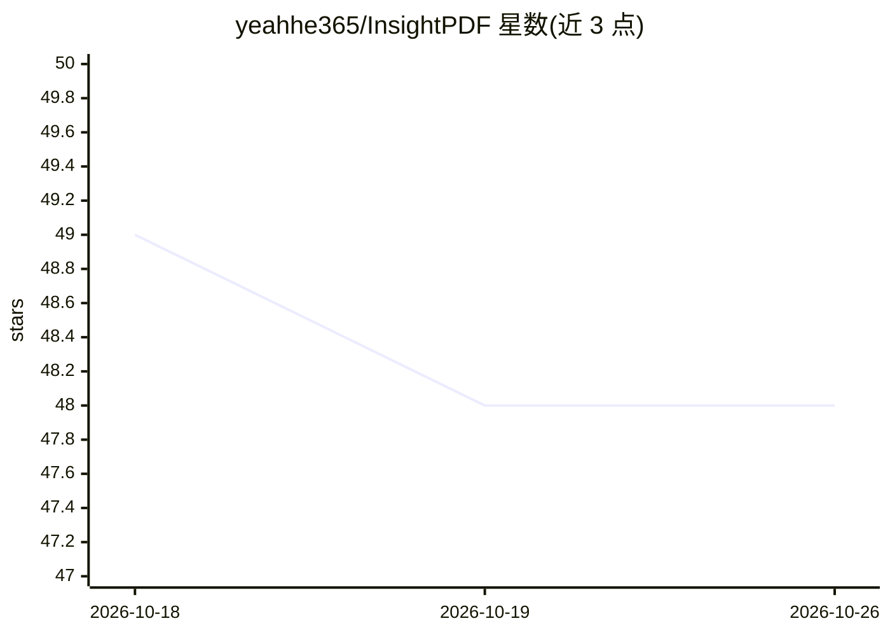

# yeahhe365/InsightPDF

⭐ 48 · TypeScript · MIT · 推送 2026-08-28 · [GitHub](https://github.com/yeahhe365/InsightPDF) · [官网](https://insightpdf.pages.dev/) · 个人维护 · 中文 README

**基于 Gemini 的 PDF 对话助手，答案带视觉定位高亮**

基于 Google Gemini 多模态模型构建的 Web 端 PDF 阅读助手：用户上传 PDF 后以对话方式提问，回答时自动跳转对应页面并用红框高亮答案来源（支持文本段落、图表、数据表格），无需传统 OCR，依赖 Gemini 3 系列原生多模态能力。支持流式传输与 Files API 处理大文件，聊天记录存储在浏览器本地。提供 AI Studio 免费版与自配 API Key 的 Web 演示版，本地部署需 Node 环境与 Gemini API Key。

## 筛选速览

| 维度 | 判定 | 备注 |
|---|---|---|
| AI 角色 | `ai-native` | 本体是模型或模型工具 |
| 许可风险 | `permissive` | MIT |
| 部署形态 | `library` | 以包/库形式分发 |
| 模型依赖 | — | README 未给出锁定关系 |
| 硬件要求 | — | 无带数字的原话,不猜 |
| 安装摩擦 | `low` | 无编译、无系统依赖或容器化 |
| 成熟度 | — | 结构信号不足 |

## 能力要点

- 视觉定位：回答自动跳转 PDF 页面并红框高亮答案来源
- 基于 Gemini 3 系列多模态能力，无需传统 OCR
- 支持流式传输与 Files API 大文件处理
- 聊天记录与设置存储于浏览器本地

## 适用场景

- 阅读长 PDF 时通过对话提问并直接看到答案出处
- 核对图表、表格类内容时定位到原文位置
- 本地部署后用自有 Gemini API Key 处理文档

## 场景标签

`文档问答` · 领域:知识与检索

## 证据(README 行号)

> L12: 基于 Google Gemini 多模态模型构建的智能文档助手，支持精确的视觉定位与边框高亮。
> L33:  AI 不仅回答问题，还会自动跳转到 PDF 对应页面，并用**红框高亮**显示答案来源（支持文本段落、图表、数据表格）。

## 星数曲线

2026-10-18 49 → 2026-10-26 48（-1）

---
*卡片 v1 · prompt 1.4 · 生成 2026-10-25 · 置信度 high · 依据 README sha `53149f5e5be0` · [字段定义](../../DATASET.md)*
