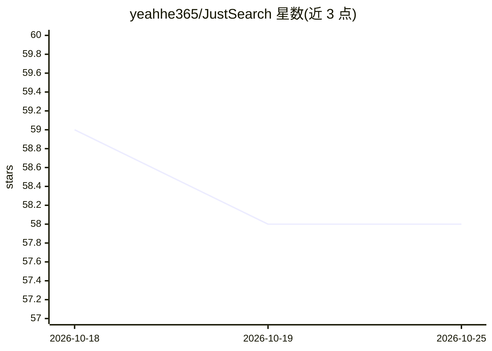

# yeahhe365/JustSearch

⭐ 58 · JavaScript · MIT · 推送 2026-08-26 · [GitHub](https://github.com/yeahhe365/JustSearch) · 个人维护 · 中文 README

**驱动真实 Chrome 的 AI 深度搜索代理，生成带引用的答案**

基于 LLM 与自建 Chrome 扩展 + 本地 WebSocket 桥接的深度搜索工具：LLM 拆解问题，在 Google/Bing/DuckDuckGo 等多引擎执行并发搜索，评估并筛选来源后驱动用户真实登录态的 Chrome 抓取网页正文（Defuddle 主引擎、交互模式自动点击展开按钮），融合多源生成带 [1][2] 编号引用的答案；信息不足时自动迭代补充搜索。提供 Web UI（流式输出、多会话、多模型切换、多语言界面），兼容 OpenAI 协议 API（DeepSeek/GPT-4/Claude/NVIDIA NIM/GLM 等），支持 Docker 与本地 Python 部署。限制：需加载 Chrome 扩展、需自备 LLM API Key。

## 筛选速览

| 维度 | 判定 | 备注 |
|---|---|---|
| AI 角色 | `ai-native` | 本体是模型或模型工具 |
| 许可风险 | `permissive` | MIT |
| 部署形态 | `self-host` | docker 或自建部署 |
| 模型依赖 | — | README 未给出锁定关系 |
| 硬件要求 | — | 无带数字的原话,不猜 |
| 安装摩擦 | `low` | 无编译、无系统依赖或容器化 |
| 成熟度 | — | 结构信号不足 |

## 能力要点

- 自建 Chrome 扩展 + WebSocket 桥接复用真实登录态，减少反爬与验证码
- 多阶段迭代流程：分析→搜索→评估→爬取交互→生成，信息不足自动再搜
- 答案强制标注来源编号引用并附原始链接
- 支持 7 种搜索引擎与多模型/多 API Key 轮询切换

## 适用场景

- 让 AI 拆解复杂问题并深度阅读网页后给出可溯源的答案
- 利用已登录浏览器抓取需登录态的页面内容
- 多会话并行开展多项搜索调研并导出 Markdown

## 场景标签

`浏览器自动化` `网页抓取` · 领域:效率与自动化

## 证据(README 行号)

> L5: **JustSearch** 是一款基于大语言模型（LLM）和浏览器桥接技术的深度搜索工具。它不仅仅是一个搜索界面，更是一个能够像人类一样"思考、搜索、阅读、总结"的智能代理。它能自动拆解复杂问题，深入网页正文提取关键信息，并生成带
> L27: - **📝 自动标注引用**：生成答案时会严格标注来源编号 `[1]`, `[2]`，并在文末提供对应的原始链接，确保信息真实可靠、可追溯。
> L190: 1. **Phase I: 分析 (Analysis)** - LLM 接收问题，决定是进行关键词搜索还是直接访问特定链接。

## 星数曲线

2026-10-18 59 → 2026-10-25 58（-1）

---
*卡片 v1 · prompt 1.4 · 生成 2026-10-24 · 置信度 mid · 依据 README sha `a23c94292816` · [字段定义](../../DATASET.md)*
