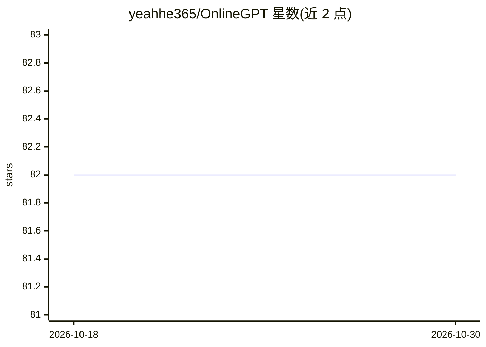

# yeahhe365/OnlineGPT

⭐ 82 · Python · MIT · 推送 2026-07-23 · [GitHub](https://github.com/yeahhe365/OnlineGPT) · [官网](https://www.yeahhe.online/OneDriveShare/%E5%B0%8F%E8%99%8E%E4%BC%9A%E4%BA%AB/%E2%8C%A8%EF%B8%8FCode/%F0%9F%90%8DPython/%F0%9F%95%B7%E7%88%AC%E8%99%AB/OnlineGPT) · 个人维护 · 中文 README

**多引擎网页搜索桌面工具，为语言模型提供实时网络信息**

基于 Python 与 PyQt5 的桌面应用，集成 Google、Bing、百度三种搜索引擎，支持普通与进阶（多行关键词+自定义问题）两种搜索模式，可调整每个关键词的结果数量。搜索结果显示于表格，支持复制、保存为文本文件与打开；内置实时日志与 Ctrl+C 中断快捷键，界面可在中英文之间切换。项目描述中说明其目的是让语言模型获取实时网络信息以辅助回答，但 README 功能部分未展示模型调用或集成机制。安装方式为 git clone 源码后 pip 安装依赖运行，无打包安装包。

## 筛选速览

| 维度 | 判定 | 备注 |
|---|---|---|
| AI 角色 | `ai-enhanced` | 去掉 AI 部分产品仍成立 |
| 许可风险 | `permissive` | MIT |
| 部署形态 | `library` | 以包/库形式分发 |
| 模型依赖 | — | README 未给出锁定关系 |
| 硬件要求 | — | 无带数字的原话,不猜 |
| 安装摩擦 | `low` | 无编译、无系统依赖或容器化 |
| 成熟度 | — | 结构信号不足 |

## 能力要点

- 集成 Google、Bing、百度三种搜索引擎
- 进阶模式支持多行关键词与自定义问题
- 结果复制/保存/打开与实时日志、快捷键中断
- 中英文界面切换

## 适用场景

- 为语言模型收集实时网络搜索信息作为回答素材
- 批量执行多关键词搜索并保存结果
- 中英文环境下桌面端检索网页信息

## 场景标签

`网页抓取` · 领域:效率与自动化

## 证据(README 行号)

> L7: **OnlineGPT 7.0** 是一个强大的在线信息搜索和管理工具，基于 Python 和 PyQt5 构建。它支持多种搜索引擎，提供高级搜索选项，并允许用户轻松复制、保存和管理搜索结果。该项目支持中英文界面，旨在为全球用户提供
> L14: - **多搜索引擎**：集成 Google、Bing 和百度，提供多样化的搜索选择。

## 星数曲线

2026-10-18 82 → 2026-10-30 82（+0）

---
*卡片 v1 · prompt 1.4 · 生成 2026-10-24 · 置信度 low · 依据 README sha `9096ca8a4557` · [字段定义](../../DATASET.md)*
