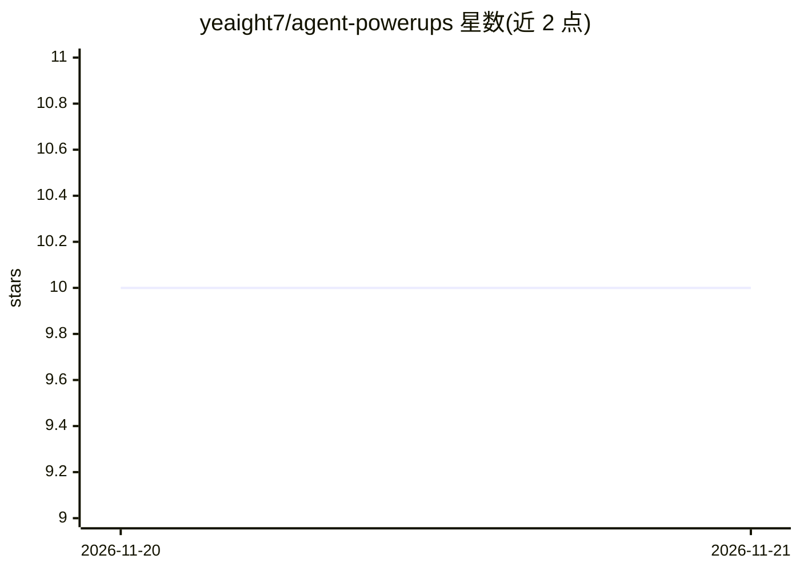

# yeaight7/agent-powerups

⭐ 10 · TypeScript · Apache-2.0 · 推送 2026-09-27 · [GitHub](https://github.com/yeaight7/agent-powerups) · 个人维护

**为编码 Agent 提供可复用技能、插件与模板的策展集合及 CLI**

以 Oh My Zsh 形式组织的编码 Agent 资产集合：skills、slash 命令、MCP 配置、hooks、AGENTS.md 模板与工作流，通过 npm 全局安装的 `apx` CLI 提供 discover、check、install、plugins、profiles 等子命令，可将资产原生安装到指定 Agent 根目录并写入 discovery-index.json。MCP 配置与 hooks 需人工审查后才启用；技能多为纯文本，仅部分声明外部工具依赖（Codex CLI、Claude Code CLI、Gemini CLI、markitdown 等）。安装目标覆盖 Codex、Claude Code、Gemini。

## 筛选速览

| 维度 | 判定 | 备注 |
|---|---|---|
| AI 角色 | `ai-ecosystem` | LLM/agent 周边工具 |
| 许可风险 | `permissive` | Apache-2.0 |
| 部署形态 | `library` | 以包/库形式分发 |
| 模型依赖 | locked-api |  |
| 硬件要求 | — | 无带数字的原话,不猜 |
| 安装摩擦 | `low` | 无编译、无系统依赖或容器化 |
| 成熟度 | — | 结构信号不足 |

## 能力要点

- `apx` CLI 提供 discover/check/install/plugins/profiles 等子命令管理资产
- 技能、命令、MCP 配置、hooks、AGENTS.md 模板多类资产随仓库分发
- MCP 配置与 hooks 为 review-before-use，需用户批准后才启用
- 支持将插件注册到 Claude/Codex marketplace 元数据与 Gemini 本地扩展

## 适用场景

- 为 Claude Code / Codex / Gemini CLI 批量安装技能与插件资产
- 按任务用 apx discover 匹配适用的技能或工作流
- 以模板快速初始化仓库的 AGENTS.md 与 hook 配置

## 场景标签

`精选清单` · 领域:学习与行业

## 证据(README 行号)

> L39: Agent Powerups is an Oh My Zsh-style collection of reusable skills, slash commands, MCP configs, hooks, AGENTS.md t
> L44: - safe local CLI (`apx`) with runnable local checks
> L72: 1. **Match first.** On Claude Code the host already lists skills natively — match the task to the narrowest fitting

## 星数曲线

2026-11-20 10 → 2026-11-21 10（+0）

---
*卡片 v1 · prompt 1.4 · 生成 2026-11-20 · 置信度 mid · 依据 README sha `0ad869fd78a5` · [字段定义](../../DATASET.md)*
