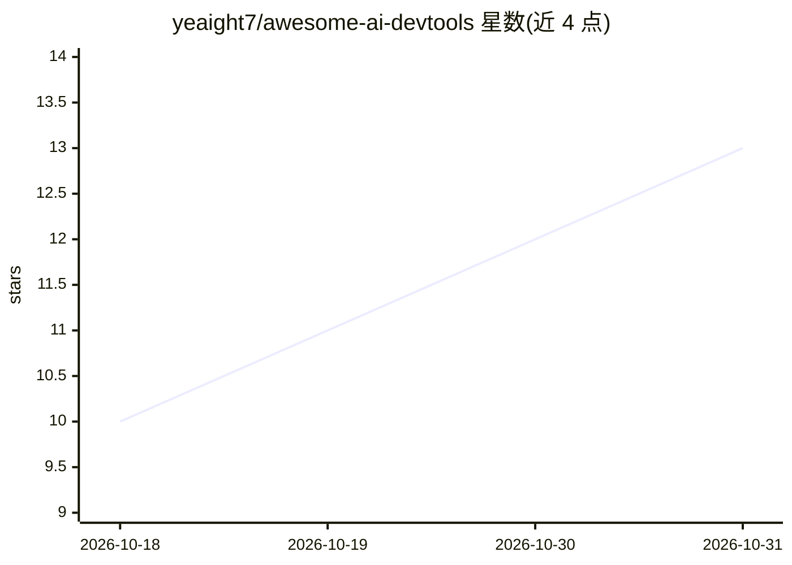

# yeaight7/awesome-ai-devtools

⭐ 13 · TypeScript · MIT · 推送 2026-10-29 · [GitHub](https://github.com/yeaight7/awesome-ai-devtools) · 个人维护

**AI 开发者工具生态地图：收录 388 个工具的策展目录**

面向 AI 开发者的工具目录：以结构化元数据收录 388 个工具（300 个已审阅、88 个草稿、18 个活跃货架），覆盖编码 agent、IDE 助手、MCP 工具、评测、可观测性、安全与自托管 AI 开发栈。提供按意图浏览的分类（构建/扩展/运维/本地运行/仓库自动化）、Top 50 对比矩阵（含 OSS/本地/CLI/IDE/MCP 等维度）与各货架明细表；明确不做排名。数据保持可排序、可审阅、带校验。

## 筛选速览

| 维度 | 判定 | 备注 |
|---|---|---|
| AI 角色 | `ai-knowledge` | 知识聚合/清单类 |
| 许可风险 | `permissive` | MIT |
| 部署形态 | `self-host` | docker 或自建部署 |
| 模型依赖 | — | README 未给出锁定关系 |
| 硬件要求 | — | 无带数字的原话,不猜 |
| 安装摩擦 | `low` | 无编译、无系统依赖或容器化 |
| 成熟度 | — | 结构信号不足 |

## 能力要点

- 388 个工具条目，300 已审阅，18 个活跃货架
- 对比矩阵覆盖 OSS/本地/自托管/CLI/IDE/MCP 维度
- 按使用意图组织：构建、扩展、运维、本地运行、仓库自动化

## 适用场景

- 按类别查找编码 agent、MCP 服务器或可观测性工具
- 对比工具的开源、本地运行与自托管属性
- 了解 AI 开发者工具生态的覆盖范围

## 场景标签

`精选清单` · 领域:学习与行业

## 证据(README 行号)

> L5:  The open-source map of the AI developer tooling ecosystem.
> L13: AI developer tooling changes quickly. This directory keeps entries in structured metadata so the public view can st
> L89: ## Comparison Matrix

## 星数曲线

2026-10-18 10 → 2026-10-31 13（+3）

---
*卡片 v1 · prompt 1.4 · 生成 2026-10-31 · 置信度 mid · 依据 README sha `038bc0eabbd0` · [字段定义](../../DATASET.md)*
