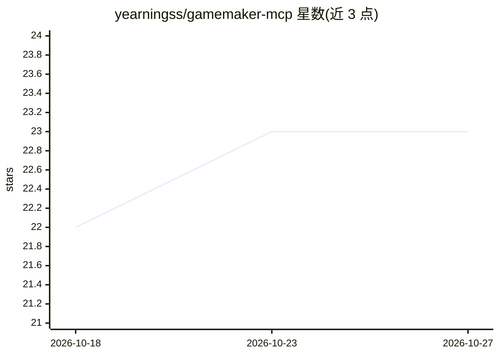

# yearningss/gamemaker-mcp

⭐ 23 · TypeScript · MIT · 推送 2026-10-21 · [GitHub](https://github.com/yearningss/gamemaker-mcp) · [官网](https://www.npmjs.com/package/gamemaker-mcp) · 个人维护

**面向 GameMaker 项目的本地 MCP 服务器：AI 客户端结构化读写与构建**

基于 stdio 的本地 Model Context Protocol 服务器，向 MCP 客户端开放 GameMaker .yyp 项目的结构化访问：资产/房间/着色器检查、GML 静态分析与复杂度诊断、带 SHA-256 并发保护与备份的守卫式编辑、项目快照与恢复，以及经 Igor 的编译打包作业。提供 165 个工具、25 个工作流提示词，CLI 安装器支持为 20 个 AI 客户端与 IDE 配置接入。默认只读模式，写与构建需显式开启；要求 Node.js 20+，编译功能另需 GameMaker Studio。

## 筛选速览

| 维度 | 判定 | 备注 |
|---|---|---|
| AI 角色 | `ai-ecosystem` | LLM/agent 周边工具 |
| 许可风险 | `permissive` | MIT |
| 部署形态 | `desktop` | 安装包/桌面程序 |
| 模型依赖 | — | README 未给出锁定关系 |
| 硬件要求 | — | 无带数字的原话,不猜 |
| 安装摩擦 | `low` | 无编译、无系统依赖或容器化 |
| 成熟度 | — | 结构信号不足 |

## 能力要点

- 165 个 MCP 工具覆盖项目检查、GML 静态分析、守卫式编辑与 Igor 构建
- SHA-256 乐观并发与备份保护文件写入，项目根路径沙箱与只读模式
- CLI 安装器可自动配置 20 个 AI 客户端与 IDE 接入
- 健康评分、死代码检测、重复代码查找等 21 项质量审计工具

## 适用场景

- 在 Claude/Cursor 等 AI 客户端中让 AI 检查与修改 GameMaker 项目
- 对 GML 代码做静态分析、性能反模式与死代码审计
- 让 AI 客户端触发 Igor 编译并读取诊断错误

## 场景标签

`编码 Agent` `代码审查` · 领域:编码与开发

## 证据(README 行号)

> L8: A project-aware local MCP server for GameMaker Studio. It gives an MCP client structured access to a `.yyp` project:
> L10: The server uses the stable `@modelcontextprotocol/sdk` v1 line over `stdio`. It does not bind a network port. File 

## 星数曲线

2026-10-18 22 → 2026-10-27 23（+1）

---
*卡片 v1 · prompt 1.4 · 生成 2026-10-27 · 置信度 high · 依据 README sha `8ce715727959` · [字段定义](../../DATASET.md)*
