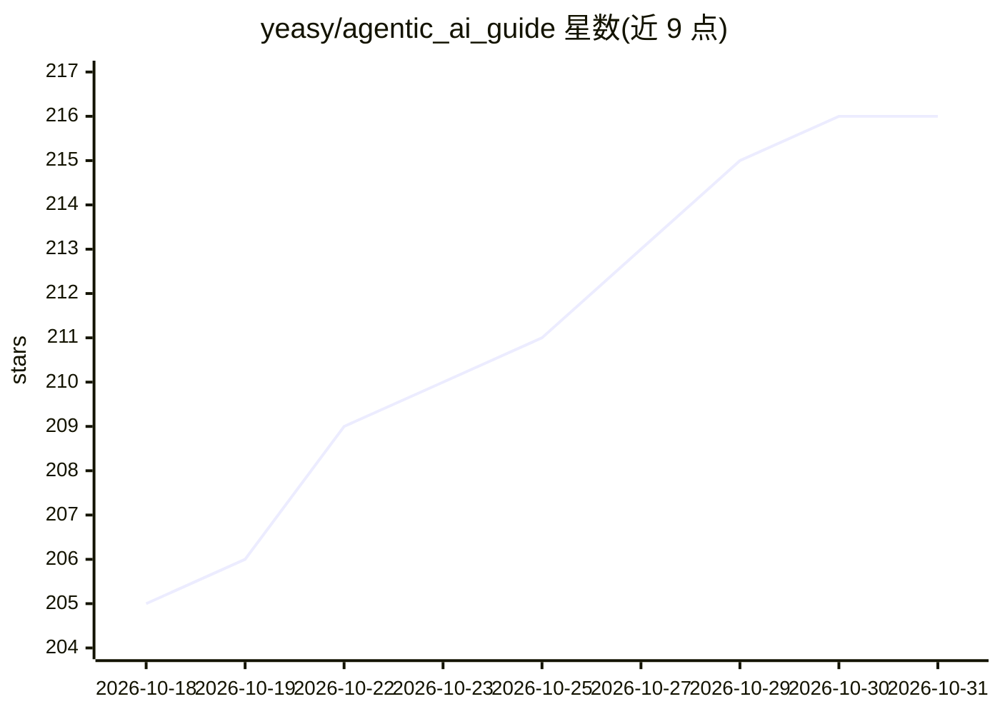

# yeasy/agentic_ai_guide

⭐ 216 · Python · 推送 2026-10-14 · [GitHub](https://github.com/yeasy/agentic_ai_guide) · [官网](https://yeasy.gitbook.io/agentic_ai_guide/) · 个人维护 · 中文 README

**面向工程师与技术决策者的智能体（Agentic AI）中文技术书籍**

开源中文技术书《智能体 AI 权威指南》，系统讲解智能体的感知、规划、记忆与行动原理，覆盖 ReAct 等架构模式、多智能体协作、强化学习与评估、AgentOps 工程实践及 Agentic Coding 等内容，并给出按读者角色（工程师/技术负责人/产品经理/研究者）划分的学习路线图与高管五站决策路线。模型 API、协议、基准等快变内容统一收录在 30 天有效期的核验表。提供 GitBook 在线版、PDF 离线版及 mdPress 本地阅读方式，许可为 CC BY-NC-SA 4.0。

## 筛选速览

| 维度 | 判定 | 备注 |
|---|---|---|
| AI 角色 | `ai-knowledge` | 知识聚合/清单类 |
| 许可风险 | `none` | — |
| 部署形态 | `None` |  |
| 模型依赖 | — | README 未给出锁定关系 |
| 硬件要求 | — | 无带数字的原话,不猜 |
| 安装摩擦 | `low` | 无编译、无系统依赖或容器化 |
| 成熟度 | — | 结构信号不足 |

## 能力要点

- 按读者角色给出章节学习路线图与高管五站决策路线
- 高波动内容（模型可用性/API/协议/基准）统一收入 30 天复核的快变事实核验表
- 提供在线阅读、PDF 下载与 mdPress 本地阅读三种方式

## 适用场景

- 从 LLM 调用进阶到智能体开发的系统学习
- 技术负责人做智能体框架选型与落地的参考
- 企业高管理解智能体技术的商业价值与风险边界

## 场景标签

`教程课程` · 领域:学习与行业

## 证据(README 行号)

> L13: 《智能体 AI 权威指南》正是为这一时代而生。本书将带你深入智能体技术的核心，从底层原理到架构设计，从主流框架到工程实践，构建完整的知识体系，助你把握这场变革的脉搏。
> L25: 通过阅读本书，你将建立起完整的智能体 AI 知识地图：

## 星数曲线

2026-10-18 205 → 2026-10-31 216（+11）

---
*卡片 v1 · prompt 1.4 · 生成 2026-10-22 · 置信度 high · 依据 README sha `861f1ad9cf5f` · [字段定义](../../DATASET.md)*
