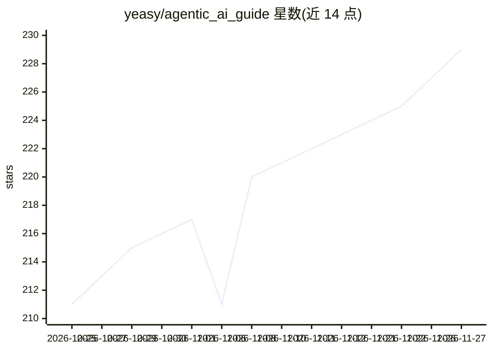

# yeasy/agentic_ai_guide

⭐ 229 · Python · 推送 2026-11-26 · [GitHub](https://github.com/yeasy/agentic_ai_guide) · [官网](https://yeasy.gitbook.io/agentic_ai_guide/) · 个人维护 · 中文 README

**面向工程师与管理者的智能体（Agentic AI）技术指南图书**

一本以 GitBook、GitHub 目录与 PDF 形式发布的智能体 AI 图书项目，覆盖单体智能架构、多智能体协作、工程实践与安全治理，按 AI 工程师、技术负责人、产品经理、研究者等角色给出不同阅读路径。提供框架选型指南、生产化检查清单、术语与论文附录，正文中的模型可用性、API 等易变信息通过 30 天有效期复核的快变事实核验表维护。本地预览需安装 mdPress 后启动服务，采用 CC BY-NC-SA 4.0 许可。

## 筛选速览

| 维度 | 判定 | 备注 |
|---|---|---|
| AI 角色 | `ai-knowledge` | 知识聚合/清单类 |
| 许可风险 | `none` | — |
| 部署形态 | `None` |  |
| 模型依赖 | — | README 未给出锁定关系 |
| 硬件要求 | — | 无带数字的原话,不猜 |
| 安装摩擦 | `low` | 无编译、无系统依赖或容器化 |
| 成熟度 | — | 结构信号不足 |

## 能力要点

- 覆盖单体智能、多智能体协作、AgentOps 与安全对齐共 12 章内容
- 按读者角色（工程师/负责人/产品/研究）提供选读路径
- 快变事实核验表按 30 天有效期复核模型可用性等易变信息
- 支持 mdPress 本地预览与 PDF 阅读

## 适用场景

- 系统学习智能体的规划、工具调用与多智能体协作机制
- 为智能体项目做框架选型与上线评审
- 为智能体试点建立治理、授权与成本收益基线

## 场景标签

`教程课程` · 领域:学习与行业

## 证据(README 行号)

> L13: 对话式大模型普及之初，人们看到的是它们的涌现能力；如今，人工智能正从“能对话的 AI”迈向“能行动的 AI”。智能体 AI（Agentic AI）让人工智能从被动响应走向主动规划，从单轮交互走向持续协作，从辅助工具走向自主伙伴，人
> L15: 《智能体 AI 权威指南》系统讲解智能体技术，内容从底层原理到架构设计，从主流框架到工程实践，构成完整的知识体系。

## 星数曲线

2026-10-25 211 → 2026-11-27 229（+18）

---
*卡片 v1 · prompt 1.4 · 生成 2026-11-26 · 置信度 high · 依据 README sha `3be634cf6719` · [字段定义](../../DATASET.md)*
