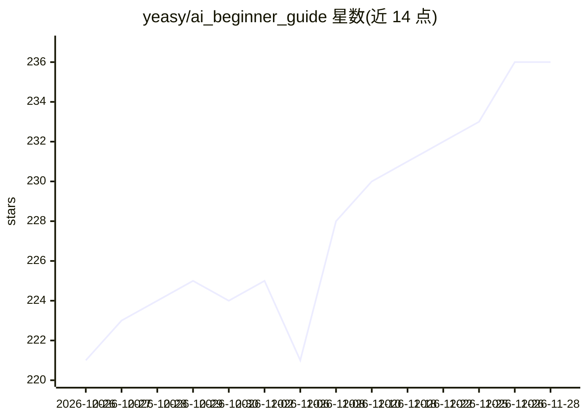

# yeasy/ai_beginner_guide

⭐ 236 · Python · 推送 2026-11-27 · [GitHub](https://github.com/yeasy/ai_beginner_guide) · [官网](https://yeasy.gitbook.io/ai_beginner_guide/) · 个人维护 · 中文 README

**面向零基础读者的 AI 入门教程书，无需编程基础**

一本以中文撰写的 AI 入门书籍，从 AI 基本概念出发，覆盖机器学习与深度学习原理、大模型与多模态、主流 AI 工具与提示词/上下文工程、智能体与安全伦理等 16 章内容，并按人文职场、AI 产品、管理决策三个方向给出选读路线。读者可通过 GitBook 在线阅读、下载 PDF，或用 mdPress 在本地预览；勘误通过 GitHub Issues 与 Pull Request 收集。

## 筛选速览

| 维度 | 判定 | 备注 |
|---|---|---|
| AI 角色 | `ai-knowledge` | 知识聚合/清单类 |
| 许可风险 | `none` | — |
| 部署形态 | `None` |  |
| 模型依赖 | — | README 未给出锁定关系 |
| 硬件要求 | — | 无带数字的原话,不猜 |
| 安装摩擦 | `low` | 无编译、无系统依赖或容器化 |
| 成熟度 | — | 结构信号不足 |

## 能力要点

- 16 章覆盖概念、原理、工具实战与进阶展望
- 提供人文职场、AI 产品、管理决策三条选读路线
- 包含提示词黄金三原则与线性回归动手实验
- 支持 GitBook 在线阅读、PDF 与本地 mdPress 预览

## 适用场景

- 零基础了解机器学习、深度学习与大模型的基本概念
- 按书中模板练习提示词改写日常提问
- 按选读路线学习 AI 工具使用或智能体知识

## 场景标签

`教程课程` `提示工程` · 领域:Agent 开发

## 证据(README 行号)

> L3: 从认识 AI 到用它解决日常问题，无需编程基础。
> L17: 这本书试图用最朴素的语言回答这些问题。它面向完全零基础的读者，从 AI 的基本概念出发，逐步走向核心技术原理，最后落到实际应用技能。无论你是好奇 AI 世界的普通用户，还是希望将 AI 技术应用于工作的职场人士，都能在这里找到一条
> L35: - **AI 基础入门（第 1–3 章）** · 理解 AI 的基本概念、发展历程与应用。从第 1 章 走进人工智能世界开始。

## 星数曲线

2026-10-26 221 → 2026-11-28 236（+15）

---
*卡片 v1 · prompt 1.4 · 生成 2026-11-25 · 置信度 high · 依据 README sha `4dfa79c8c5c7` · [字段定义](../../DATASET.md)*
