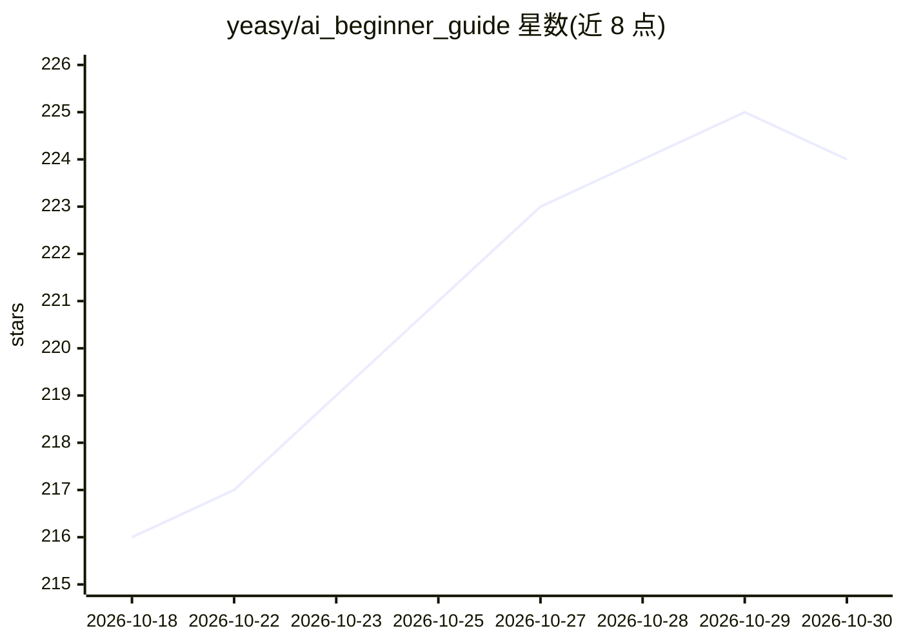

# yeasy/ai_beginner_guide

⭐ 224 · Python · 推送 2026-10-23 · [GitHub](https://github.com/yeasy/ai_beginner_guide) · [官网](https://yeasy.gitbook.io/ai_beginner_guide/) · 个人维护 · 中文 README

**面向零基础读者的 AI 入门书籍（16 章，含实验与学习路线）**

一本 CC BY-NC-SA 4.0 许可的中文 AI 入门图书，主体 16 章分四部分：基础概念、核心技术解析、主流工具与提示词实战、智能体与安全伦理展望。设 A/B 双轨学习路线：A 轨面向无编程基础的使用者，B 轨要求 Python 3.11+ 与命令行，可在不使用在线 API 的情况下完成 labs/ 目录中的五个实验。支持 GitBook 在线阅读与 GitHub Releases 下载 PDF，本地预览需安装 mdPress。

## 筛选速览

| 维度 | 判定 | 备注 |
|---|---|---|
| AI 角色 | `ai-knowledge` | 知识聚合/清单类 |
| 许可风险 | `none` | — |
| 部署形态 | `None` |  |
| 模型依赖 | — | README 未给出锁定关系 |
| 硬件要求 | — | 无带数字的原话,不猜 |
| 安装摩擦 | `low` | 无编译、无系统依赖或容器化 |
| 成熟度 | — | 结构信号不足 |

## 能力要点

- 16 章四部分结构，覆盖概念、原理、工具实战与前沿
- A/B 双轨学习路线，含可交付物与验收标准
- B 轨五个实验可离线完成（不依赖在线 API 与密钥）
- 按角色（文科生/职场人士/管理者等）给出差异化章节路线与时数建议

## 适用场景

- 零基础读者系统学习 AI 概念与工具使用
- 职场人士快速掌握提示词工程提升工作效率
- 有编程基础者通过五个实验理解技术原理

## 场景标签

`教程课程` · 领域:学习与行业

## 证据(README 行号)

> L9: > 普通人看的 AI 入门。从零开始，掌握人工智能的核心知识与实践技能
> L19: 这本书试图用最朴素的语言回答这些问题。它面向完全零基础的读者，从 AI 的基本概念出发，逐步走向核心技术原理，最后落到实际应用技能。无论你是好奇 AI 世界的普通用户，还是希望将 AI 技术应用于工作的职场人士，都能在这里找到一条
> L116: 本书主体内容共分为四个部分：

## 星数曲线

2026-10-18 216 → 2026-10-30 224（+8）

---
*卡片 v1 · prompt 1.4 · 生成 2026-10-22 · 置信度 high · 依据 README sha `8728b241c974` · [字段定义](../../DATASET.md)*
