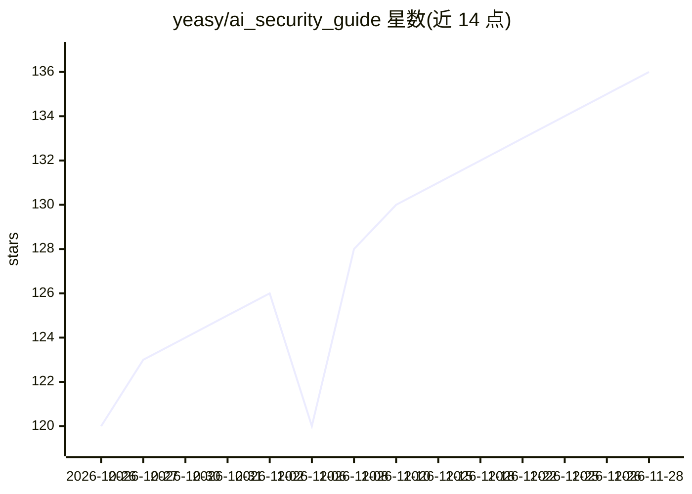

# yeasy/ai_security_guide

⭐ 136 · Python · 推送 2026-11-26 · [GitHub](https://github.com/yeasy/ai_security_guide) · [官网](https://yeasy.gitbook.io/ai_security_guide) · 组织维护 · 中文 README

**面向开发者的大语言模型与智能体安全攻防指南**

一本讲解大语言模型与智能体攻击原理、防御机制与验证方法的指南书籍，内容覆盖对齐检测、授权隔离、RAG 访问控制、多智能体身份与委托授权、合规治理等主题。以邮件助手、支付预算、RAG 轨迹三个 Python 本地实验作为配套练习，实验仅使用 Python 标准库和固定合成数据，不依赖真实模型调用。提供 GitBook 在线阅读、GitHub 目录与 PDF 发布页，采用 CC BY-NC-SA 4.0 许可。

## 筛选速览

| 维度 | 判定 | 备注 |
|---|---|---|
| AI 角色 | `ai-knowledge` | 知识聚合/清单类 |
| 许可风险 | `none` | — |
| 部署形态 | `None` |  |
| 模型依赖 | — | README 未给出锁定关系 |
| 硬件要求 | — | 无带数字的原话,不猜 |
| 安装摩擦 | `low` | 无编译、无系统依赖或容器化 |
| 成熟度 | — | 结构信号不足 |

## 能力要点

- 配套三个本地 Python 实验（邮件助手、可信预算、RAG 授权）
- 学习路线按学习任务划分并配对应章节与练习
- 含合规治理模板与策略实现的附录
- 以数据流标注与权限检查为核心学习方法

## 适用场景

- 第一次学习大模型安全，梳理应用的数据流与权限
- 加固使用知识库或工具调用的大模型应用
- 为智能体系统做安全治理与交付验收记录

## 场景标签

`网络安全` `教程课程` · 领域:学习与行业

## 证据(README 行号)

> L13: 本书讲解大语言模型与智能体的攻击原理、防御机制和验证方法。以邮件助手为例：模型读取来信，选择文档并请求发送；安全设计要查清来信能影响哪些参数、文档允许谁读取、谁批准发送，以及失败重试会不会重复执行。
> L40: 实验使用 Python 标准库和固定合成数据，包含正常请求与控制失效的对照用例。

## 星数曲线

2026-10-26 120 → 2026-11-28 136（+16）

---
*卡片 v1 · prompt 1.4 · 生成 2026-11-28 · 置信度 high · 依据 README sha `e933f3198341` · [字段定义](../../DATASET.md)*
