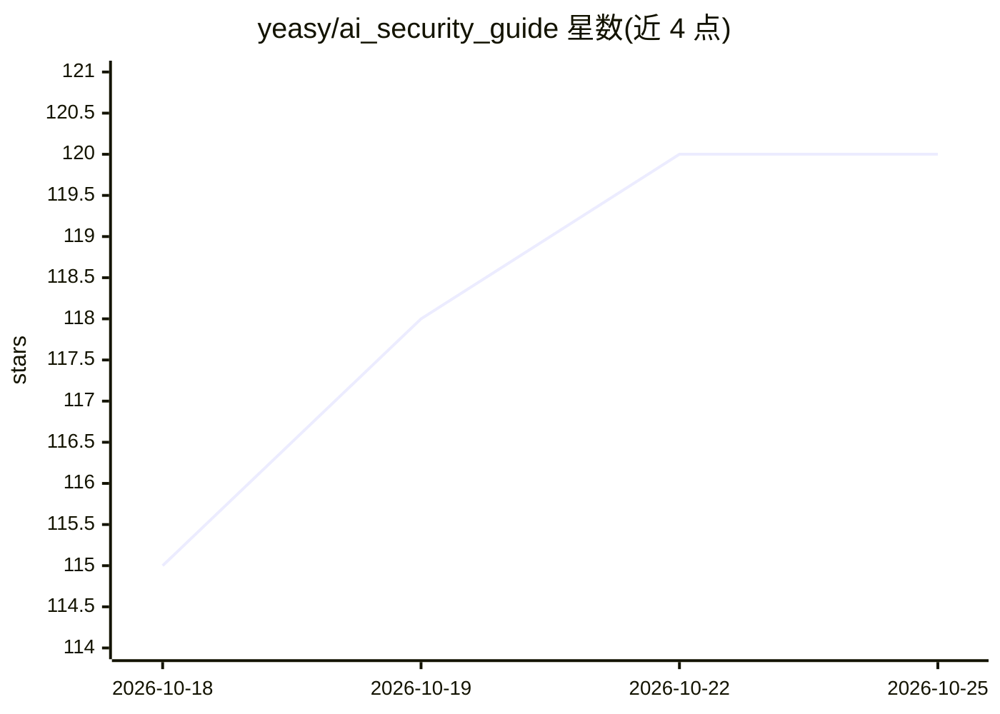

# yeasy/ai_security_guide

⭐ 120 · Python · 推送 2026-10-14 · [GitHub](https://github.com/yeasy/ai_security_guide) · [官网](https://yeasy.gitbook.io/ai_security_guide) · 个人维护 · 中文 README

**面向工程师的大模型与智能体安全攻防图书（含配套实验）**

系统讲解大语言模型与智能体的攻击原理、防御机制和验证方法的技术书籍，共 15 章，覆盖攻击分析、防御实现、智能体系统设计与治理交付；配套三个 Python 实验仓库根目录可运行，实验仅用 Python 标准库与固定合成数据，不测真实模型攻击成功率或生产系统。阅读需要 Python、HTTP、身份权限与日志基础，训练相关章节另需概率统计与线性代数。提供 GitBook 在线版与 PDF（GitHub Releases）两种阅读方式。

## 筛选速览

| 维度 | 判定 | 备注 |
|---|---|---|
| AI 角色 | `ai-knowledge` | 知识聚合/清单类 |
| 许可风险 | `none` | — |
| 部署形态 | `None` |  |
| 模型依赖 | — | README 未给出锁定关系 |
| 硬件要求 | — | 无带数字的原话,不猜 |
| 安装摩擦 | `low` | 无编译、无系统依赖或容器化 |
| 成熟度 | — | 结构信号不足 |

## 能力要点

- 15 章覆盖攻击分析、防御验证、智能体设计与治理
- 邮件助手、支付预算、RAG 轨迹三个配套实验（Python 标准库+合成数据）
- GitBook 在线阅读与 PDF 下载两种获取方式
- 给出按学习任务划分的阅读路径与练习

## 适用场景

- 开发 LLM/智能体应用前学习安全设计与防御验证方法
- 通过配套实验观察读取授权、发送判定、并发预留等内部行为
- 按章节自查系统中的越权读取、发送与执行风险

## 场景标签

`网络安全` `教程课程` · 领域:学习与行业

## 证据(README 行号)

> L20: 本书讲解大语言模型与智能体的攻击原理、防御机制和验证方法。以邮件助手为例：模型读取来信，选择文档并请求发送；安全设计要查清来信能影响哪些参数、文档允许谁读取、谁批准发送，以及失败重试会不会重复执行。
> L22: 阅读时始终区分两个问题：模型产生危险输出的概率能否降低；即使模型输出错误，系统是否仍能阻止越权读取、发送或执行。前者涉及对齐与检测，后者依赖模型之外的授权、隔离和执行检查。每种控制都须说明适用条件与未覆盖的路径。

## 星数曲线

2026-10-18 115 → 2026-10-25 120（+5）

---
*卡片 v1 · prompt 1.4 · 生成 2026-10-23 · 置信度 high · 依据 README sha `ca2ed3466636` · [字段定义](../../DATASET.md)*
