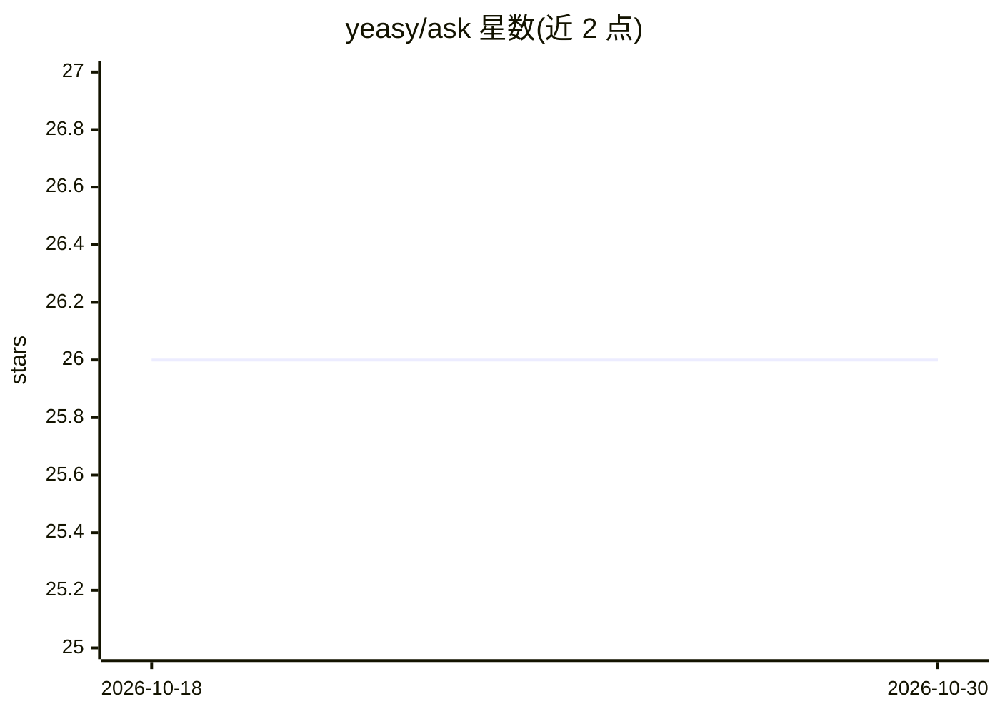

# yeasy/ask

⭐ 26 · HTML · MIT · 推送 2026-08-25 · [GitHub](https://github.com/yeasy/ask) · 个人维护 · 中文 README

**跨 19 种 Agent 的技能包管理 CLI：搜索、安装、同步、安全扫描**

用 Go 编写的命令行技能包管理器：一次安装技能，自动同步到 Claude、Cursor、Codex、Copilot、Windsurf、Gemini CLI 等 19 种 agent 的技能目录。提供 ask.lock 版本锁定（类 npm ci 的 lock-install）、12+ 条规则的安全扫描与 SARIF/HTML 审计报告、离线模式与私有仓库支持、来源白名单。预置 Anthropic/OpenAI/Vercel/Composio 等技能源，另提供 ask serve 网页界面与 Wails 桌面应用。面向需要跨工具统一管理 agent 技能的开发者与团队。

## 筛选速览

| 维度 | 判定 | 备注 |
|---|---|---|
| AI 角色 | `ai-ecosystem` | LLM/agent 周边工具 |
| 许可风险 | `permissive` | MIT |
| 部署形态 | `library` | 以包/库形式分发 |
| 模型依赖 | — | README 未给出锁定关系 |
| 硬件要求 | — | 无带数字的原话,不猜 |
| 安装摩擦 | `low` | 无编译、无系统依赖或容器化 |
| 成熟度 | — | 结构信号不足 |

## 能力要点

- 一次安装同步到 19 种 agent，避免供应商锁定
- ask.lock 版本锁定与 CI/CD 用 lock-install
- 12+ 条规则安全扫描，输出 SARIF 与 HTML 审计报告
- 提供网页界面（ask serve）与 Wails 桌面应用

## 适用场景

- 在多个 AI 编程工具间统一安装和同步技能
- 团队用 lock 文件复现同一套技能版本
- 安装前扫描第三方技能的安全风险
- 离线或私有仓库环境下管理企业内部技能

## 场景标签

 · 领域:开发者工具/AI 基础设施

## 证据(README 行号)

> L7:  Install once — works with Claude, Cursor, Codex, Copilot, Windsurf, Gemini, OpenClaw, and 12 more.
> L43: |**🤖 19 Agents, One CLI**|Install once, auto-sync to Claude, Cursor, Codex, Copilot, Windsurf, Gemini CLI, OpenClaw
> L44: |**📦 Version Locking**|`ask.lock` pins exact commits for reproducible builds. `ask lock-install` for CI/CD like `np

## 星数曲线

2026-10-18 26 → 2026-10-30 26（+0）

---
*卡片 v1 · prompt 1.4 · 生成 2026-10-26 · 置信度 high · 依据 README sha `cac0b3c43700` · [字段定义](../../DATASET.md)*
