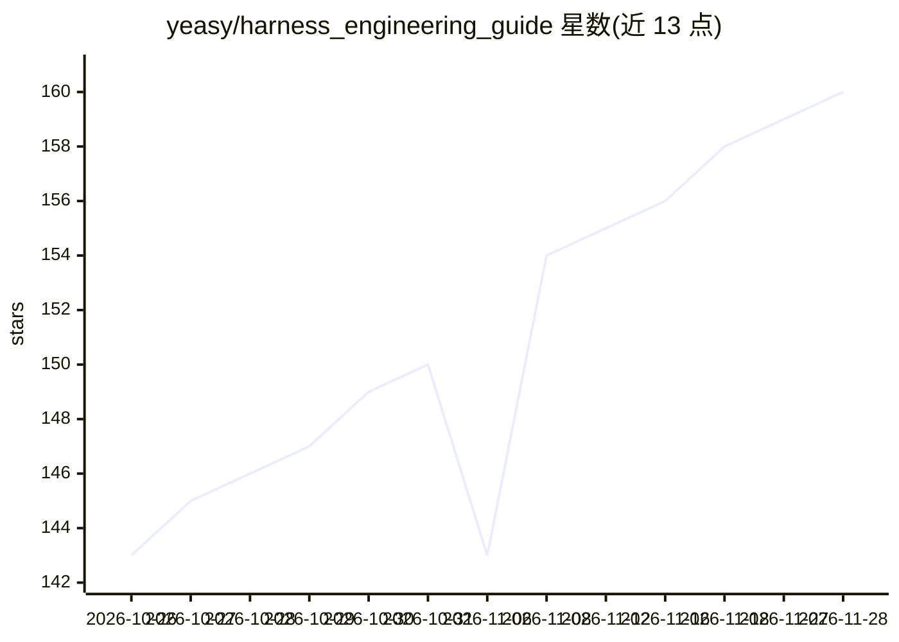

# yeasy/harness_engineering_guide

⭐ 160 · Python · 推送 2026-11-27 · [GitHub](https://github.com/yeasy/harness_engineering_guide) · [官网](https://yeasy.gitbook.io/harness_engineering_guide) · 个人维护 · 中文 README

**面向工程师的智能体 Harness 工程开源图书与实战指南**

一本开源电子书，讲述如何设计智能体的运行时、工具、记忆与安全机制，并提供 Python 实战项目 MiniHarness 供读者跟做实现。全书分 14 章覆盖 Harness 基础、核心子系统、系统集成、安全与评估，并以 OpenAI Codex、Claude Code、OpenClaw 三个生产级系统作为参考案例进行架构比较。目标读者为具备 AI Agent 基础与 Python 经验的工程师、架构师和技术决策者，内容以 GitBook 在线阅读、GitHub 目录与发布页 PDF 形式提供。

## 筛选速览

| 维度 | 判定 | 备注 |
|---|---|---|
| AI 角色 | `ai-knowledge` | 知识聚合/清单类 |
| 许可风险 | `none` | — |
| 部署形态 | `None` |  |
| 模型依赖 | — | README 未给出锁定关系 |
| 硬件要求 | — | 无带数字的原话,不猜 |
| 安装摩擦 | `low` | 无编译、无系统依赖或容器化 |
| 成熟度 | — | 结构信号不足 |

## 能力要点

- Python 实战项目 MiniHarness 逐章构建完整 Harness 子系统
- Codex/Claude Code/OpenClaw 三个参考系统的多维度架构对比表
- 按 Agent 平台工程师、架构师、全栈开发者等角色给出选读路径
- mdPress 本地预览支持

## 适用场景

- 系统学习智能体运行时、工具层、记忆与安全的设计方法
- 按角色查阅生产级 Harness 的构建、可靠性、安全与评估章节
- 跟做 MiniHarness 掌握从脚手架到安全层的完整实现

## 场景标签

`教程课程` · 领域:学习与行业

## 证据(README 行号)

> L1: # 智能体 Harness 工程指南
> L3: 设计智能体的运行时、工具、记忆与安全机制，并用 Python 逐步实现 MiniHarness。
> L25: 本书面向具备 AI Agent 基础的工程师、架构师和技术决策者。跟做 MiniHarness 需要 Python 编程经验。

## 星数曲线

2026-10-26 143 → 2026-11-28 160（+17）

---
*卡片 v1 · prompt 1.4 · 生成 2026-11-27 · 置信度 high · 依据 README sha `4402820eccb3` · [字段定义](../../DATASET.md)*
