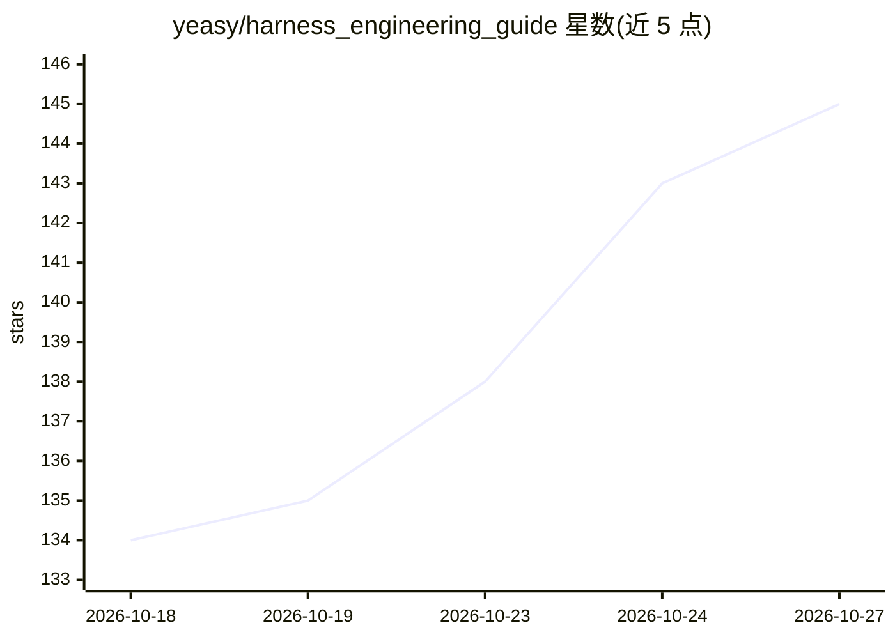

# yeasy/harness_engineering_guide

⭐ 145 · Python · 推送 2026-10-25 · [GitHub](https://github.com/yeasy/harness_engineering_guide) · [官网](https://yeasy.gitbook.io/harness_engineering_guide) · 个人维护 · 中文 README

**剖析智能体 Harness 工程原理与实现的中文技术书**

一本聚焦 Agent 工程基础设施的中文开源技术书（14 章，CC BY-NC-SA 4.0），核心论点为"智能体 = 大模型 + Harness"。全书以 OpenAI Codex、Claude Code、OpenClaw 三个生产级系统为参考案例，拆解运行时引擎、工具层、记忆子系统、编排、安全与可观测性等子系统，并贯穿一个用 Python 从零实现的实战项目 MiniHarness。面向 Agent 平台工程师、AI 应用架构师、全栈开发者与技术决策者，提供 GitBook 在线版、PDF 下载与 mdPress 本地阅读方式。

## 筛选速览

| 维度 | 判定 | 备注 |
|---|---|---|
| AI 角色 | `ai-knowledge` | 知识聚合/清单类 |
| 许可风险 | `none` | — |
| 部署形态 | `None` |  |
| 模型依赖 | — | README 未给出锁定关系 |
| 硬件要求 | — | 无带数字的原话,不猜 |
| 安装摩擦 | `low` | 无编译、无系统依赖或容器化 |
| 成熟度 | — | 结构信号不足 |

## 能力要点

- 以 Codex/Claude Code/OpenClaw 三系统为参考案例，附维度对比表
- 贯穿全书从零构建的 Python 实战项目 MiniHarness
- 覆盖运行时、工具层、记忆、编排、MCP、安全、可观测性等子系统
- 提供 GitBook 在线版、PDF 离线版与 mdPress 本地阅读

## 适用场景

- 系统学习如何构建驱动智能体的工程基础设施
- 跟随 MiniHarness 项目动手实现完整 Agent Harness
- 对比三个生产级系统的设计取舍用于选型参考

## 场景标签

`教程课程` · 领域:学习与行业

## 证据(README 行号)

> L3: > 智能体 = 大模型 + Harness。深入剖析 Harness 工程原理、设计、实现。
> L45: ## 实战项目：MiniHarness

## 星数曲线

2026-10-18 134 → 2026-10-27 145（+11）

---
*卡片 v1 · prompt 1.4 · 生成 2026-10-23 · 置信度 high · 依据 README sha `2f6764098cf2` · [字段定义](../../DATASET.md)*
