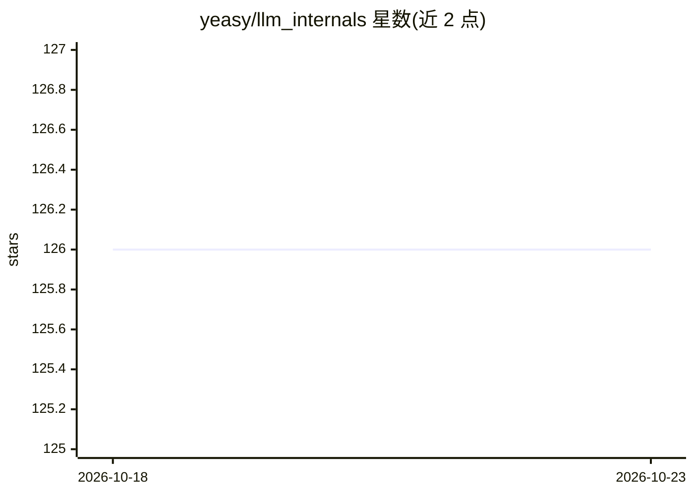

# yeasy/llm_internals

⭐ 126 · Python · 推送 2026-10-14 · [GitHub](https://github.com/yeasy/llm_internals) · [官网](https://yeasy.gitbook.io/llm_internals/) · 个人维护 · 中文 README

**讲解 Transformer 与大模型架构、训练、推理部署的中文开源书籍**

以 Transformer 为核心的技术书籍，共四部分与附录：基础篇解析注意力机制及各组件设计动因，训练篇覆盖预训练、分布式训练与对齐方法，推理与部署篇拆解解码原理、KV 缓存、量化等优化技术，模型与前沿篇讨论 GPT/Llama/DeepSeek-V3 等架构与前沿方向。面向 AI/NLP 研究者、算法工程师、机器学习从业者与高校师生，提供按角色划分的学习路线与推导、计算、代码三类验收要求。通过 GitBook 在线阅读、Releases 下载 PDF，或本地用 mdPress 构建，许可为 CC BY-NC-SA 4.0。

## 筛选速览

| 维度 | 判定 | 备注 |
|---|---|---|
| AI 角色 | `ai-knowledge` | 知识聚合/清单类 |
| 许可风险 | `none` | — |
| 部署形态 | `None` |  |
| 模型依赖 | — | README 未给出锁定关系 |
| 硬件要求 | — | 无带数字的原话,不猜 |
| 安装摩擦 | `low` | 无编译、无系统依赖或容器化 |
| 成熟度 | — | 结构信号不足 |

## 能力要点

- 四部分结构：基础/训练/推理部署/模型与前沿，另附 PyTorch 示例与参考文献
- 按读者角色（初学者/算法/系统/研究）给出学习路线与三类验收要求
- 解释设计决策背后的动机：缩放因子、RoPE 外推、KV 缓存、MoE 等
- 提供在线阅读、PDF 下载与 mdPress 本地阅读三种方式

## 适用场景

- 系统学习 Transformer 原理与大模型训练推理技术
- 算法工程师/系统工程师按路线图进阶并完成实验验收
- 离线下载 PDF 阅读或本地构建书稿

## 场景标签

 · 领域:AI 知识/技术教育

## 证据(README 行号)

> L9: > 以 Transformer 为例，深入剖析大模型为什么能工作、为什么这样设计，系统掌握从架构原理到训练部署的完整知识体系。
> L19: 本书的核心目标，是帮助读者建立对 Transformer 及其衍生模型的**深层理解**，并能独立实现、验证和改进训练与推理系统：
> L50: 本书共分为四个部分和附录：

## 星数曲线

2026-10-18 126 → 2026-10-23 126（+0）

---
*卡片 v1 · prompt 1.4 · 生成 2026-10-23 · 置信度 high · 依据 README sha `b28f38880fe9` · [字段定义](../../DATASET.md)*
