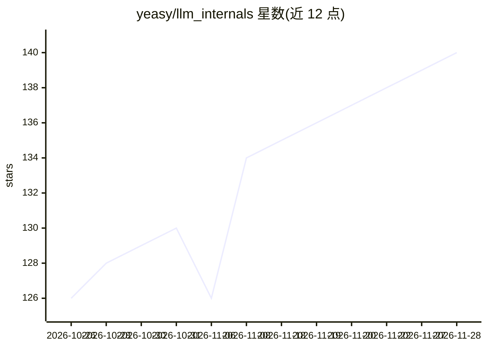

# yeasy/llm_internals

⭐ 140 · Python · 推送 2026-11-26 · [GitHub](https://github.com/yeasy/llm_internals) · [官网](https://yeasy.gitbook.io/llm_internals/) · 个人维护 · 中文 README

**面向大模型学习者的 Transformer 原理与训练部署技术书**

一本讲解大语言模型设计与实现原理的中文技术书籍，以 Transformer 为核心，覆盖注意力机制、位置编码、预训练目标函数、分布式训练与对齐（RLHF/DPO）、推理瓶颈分析与 KV 缓存、连续批处理等部署主题。全书按基础、训练、推理部署、模型前沿四篇组织，为 AI 初学者、算法工程师、系统工程师与研究人员分别给出学习路线，每条路线附推导、计算与代码三类验收要求，附录提供可运行的 PyTorch 实验示例。通过 GitBook 在线阅读，提供 PDF 版本，本地预览依赖 mdPress 工具，采用 CC BY-NC-SA 4.0 许可证。

## 筛选速览

| 维度 | 判定 | 备注 |
|---|---|---|
| AI 角色 | `ai-knowledge` | 知识聚合/清单类 |
| 许可风险 | `none` | — |
| 部署形态 | `None` |  |
| 模型依赖 | — | README 未给出锁定关系 |
| 硬件要求 | — | 无带数字的原话,不猜 |
| 安装摩擦 | `low` | 无编译、无系统依赖或容器化 |
| 成熟度 | — | 结构信号不足 |

## 能力要点

- 按基础/训练/推理部署/前沿四篇共 14 章组织内容
- 为四类读者角色分别提供学习路线与推导/计算/代码验收标准
- 附录含可运行的 PyTorch 示例（attention、RoPE、RMSNorm）与复现实验
- 通过 GitBook 在线阅读，提供 PDF 版本

## 适用场景

- 系统学习 Transformer 架构的设计原理与数学推导
- 理解分布式训练、混合精度等训练工程的取舍依据
- 分析推理瓶颈并学习 KV 缓存、连续批处理等部署技术
- 高校深度学习与大模型方向的教学参考

## 场景标签

`教程课程` · 领域:学习与行业

## 证据(README 行号)

> L1: # 大模型原理与架构
> L3: 以 Transformer 为例，理解大模型的设计原理、训练方法与推理部署。
> L27: ## 全书结构

## 星数曲线

2026-10-26 126 → 2026-11-28 140（+14）

---
*卡片 v1 · prompt 1.4 · 生成 2026-11-27 · 置信度 high · 依据 README sha `68c60756f651` · [字段定义](../../DATASET.md)*
