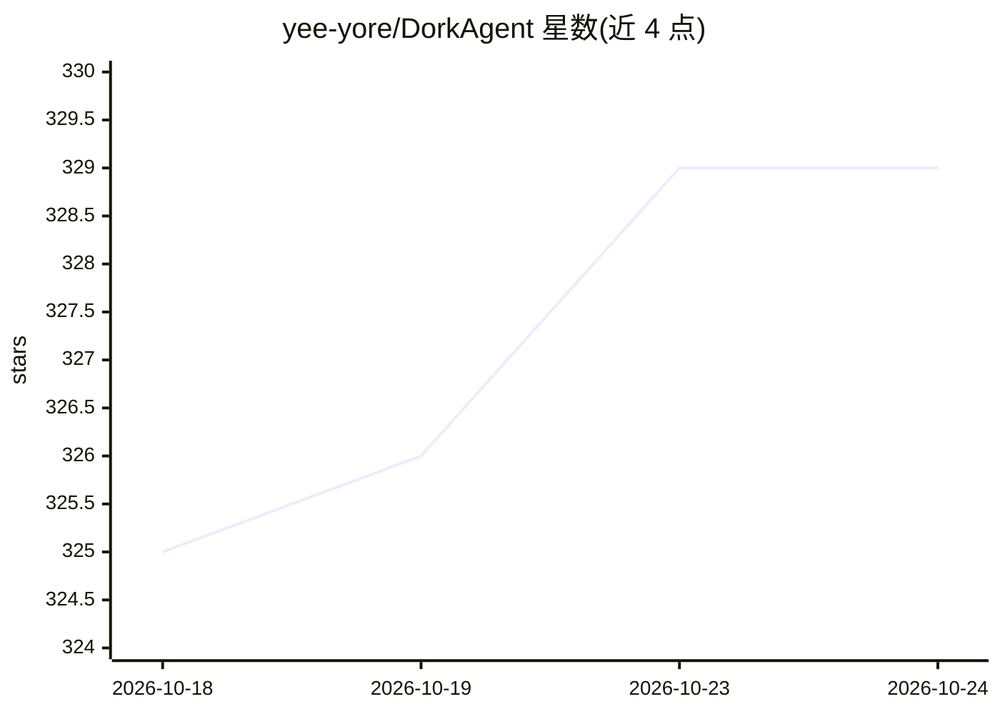

# yee-yore/DorkAgent

⭐ 329 · Python · MIT · 推送 2026-08-24 · [GitHub](https://github.com/yee-yore/DorkAgent) · 个人维护

**LLM 驱动的自动化 Google Dorking 代理，用于渗透测试与赏金狩猎**

基于 CrewAI 多代理框架构建的 Google Dorking 自动化工具：用户输入目标域名后，代理生成并执行 Google dork 查询（依赖 Serper 或 SerpApi 搜索引擎 API），检索暴露的敏感信息并生成带时间戳的安全报告。运行时交互式选择搜索引擎与 LLM 提供商（OpenAI/Anthropic/Gemini，至少需一个 API key），首次运行自动安装依赖。要求 Python 3.11.x（3.13+ 下 tiktoken 无预编译 wheel 可能构建失败）。通过 git clone 源码运行，无打包发布。面向渗透测试与 bug bounty 从业者。

## 筛选速览

| 维度 | 判定 | 备注 |
|---|---|---|
| AI 角色 | `ai-native` | 本体是模型或模型工具 |
| 许可风险 | `permissive` | MIT |
| 部署形态 | `None` |  |
| 模型依赖 | — | README 未给出锁定关系 |
| 硬件要求 | — | 无带数字的原话,不猜 |
| 安装摩擦 | `low` | 无编译、无系统依赖或容器化 |
| 成熟度 | — | 结构信号不足 |

## 能力要点

- 基于 CrewAI 多代理自动生成并执行 Google dork 查询
- 运行时可选搜索引擎（Serper/SerpApi）与 LLM 提供商
- 首次运行自动安装依赖并将 API key 写入 .env
- 生成带时间戳的安全信息披露报告

## 适用场景

- 赏金狩猎中自动化收集目标暴露面信息
- 渗透测试侦察阶段批量执行 Google dork 查询
- OSINT 场景下发现目标的敏感文档与参数

## 场景标签

 · 领域:网络安全/渗透测试

## 证据(README 行号)

> L2: 🤖 LLM-powered agent for automated Google Dorking in bug hunting &amp; pentesting.
> L24: - **Prompt you to choose a search engine** (Serper or SerpApi) and an LLM provider

## 星数曲线

2026-10-18 325 → 2026-10-24 329（+4）

---
*卡片 v1 · prompt 1.4 · 生成 2026-10-22 · 置信度 high · 依据 README sha `03fc220c56a2` · [字段定义](../../DATASET.md)*
