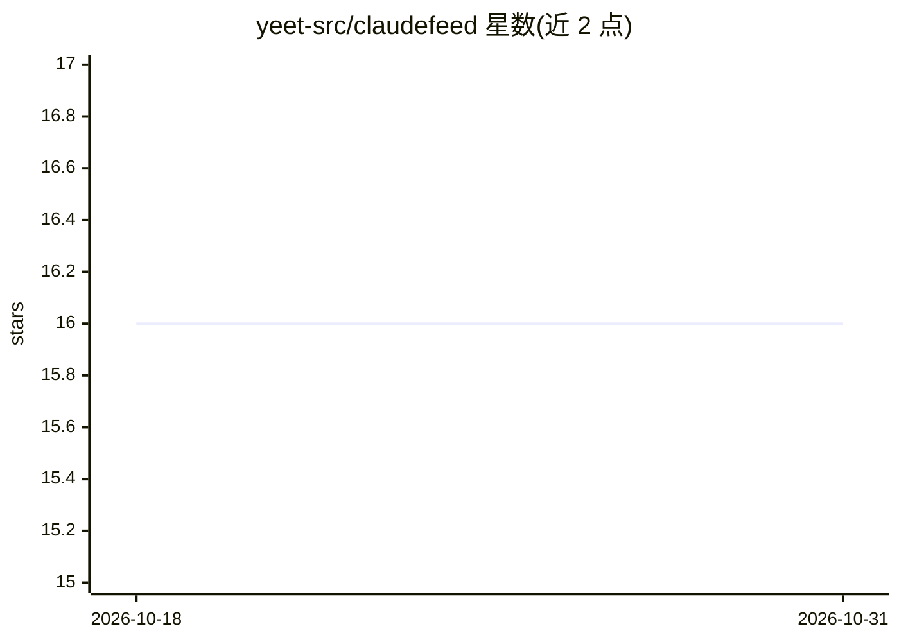

# yeet-src/claudefeed

⭐ 16 · C · 推送 2026-10-22 · [GitHub](https://github.com/yeet-src/claudefeed) · [官网](https://yeet.cx) · 组织维护

**用 eBPF 从内核层实时审计编码 agent 会话行为的 Linux 工具**

claudefeed 是基于 eBPF 的 Linux 会话审计工具：在内核中按进程子树范围捕获编码 agent（默认匹配 claude 进程名，可 --match 任意程序名）会话的每一项命令执行、文件打开、TCP 连接与监听事件，以追加式单行日志流式输出。核心机制是内核内 tracked 哈希表跟踪进程集合：JS 启动时种子化、exec 时自传播、exit 时修剪，过滤在进入用户态前完成。仅观察记录、不阻断，单机单会话、无持久化；通过安装 yeet 运行时运行，构建需 bpftool 生成 vmlinux.h。

## 筛选速览

| 维度 | 判定 | 备注 |
|---|---|---|
| AI 角色 | `ai-ecosystem` | LLM/agent 周边工具 |
| 许可风险 | `none` | — |
| 部署形态 | `None` |  |
| 模型依赖 | — | README 未给出锁定关系 |
| 硬件要求 | — | 无带数字的原话,不猜 |
| 安装摩擦 | `low` | 无编译、无系统依赖或容器化 |
| 成熟度 | — | 结构信号不足 |

## 能力要点

- 内核态 eBPF 捕获 exec/exit/open/conn/listen 五类事件，按会话进程子树过滤
- tracked tgid 哈希表经 exec 自传播，覆盖深层子进程且非会话进程仅一次哈希查找
- --match 程序名前缀匹配可审计任意 agent（node/python/codex 等），非编译期假设
- 追加式输出可安全管道重定向为纯文本审计记录，--secs 支持有界可脚本化运行

## 适用场景

- 团队推广编码 agent 前用真实证据盘点其在开发机上的实际行为
- SSH 到无法安装监控栈的服务器上三十秒内查看 agent 会话在做什么
- 对无人值守的 agent 运行核对其按序实际执行的命令与外连地址
- 在 EVT_OPEN/EVT_CONNECT 回调中加谓词实现轻量越界告警

## 场景标签

`LLM 可观测性` `网络安全` · 领域:评测与运维

## 证据(README 行号)

> L13: **`claudefeed` is an eBPF agent audit feed for Linux: it streams every command, file open and TCP connection a codi
> L104: **Is this a replacement for auditd, Falco, or an EDR agent?**

## 星数曲线

2026-10-18 16 → 2026-10-31 16（+0）

---
*卡片 v1 · prompt 1.4 · 生成 2026-10-30 · 置信度 high · 依据 README sha `c47194c64179` · [字段定义](../../DATASET.md)*
