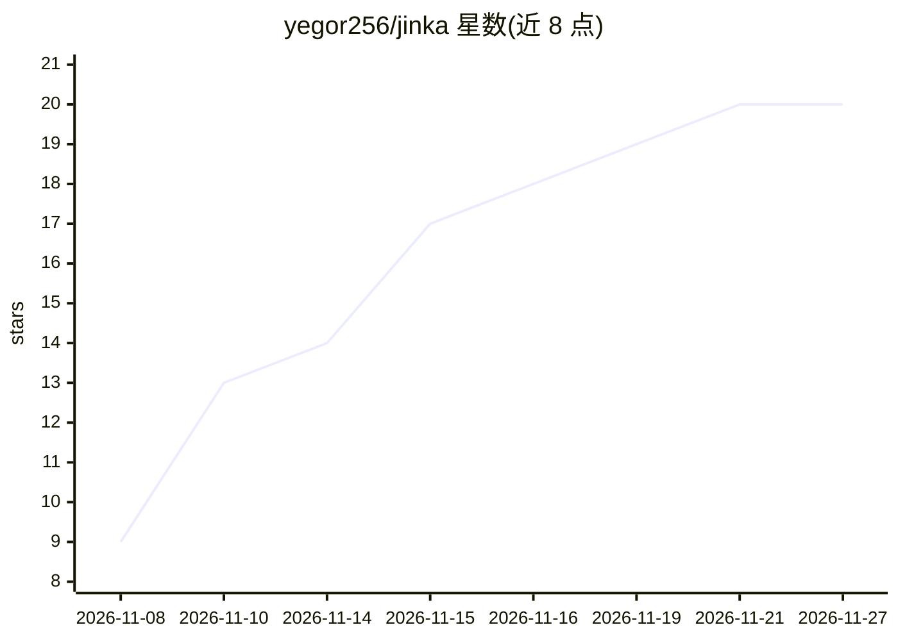

# yegor256/jinka

⭐ 20 · JavaScript · MIT · 推送 2026-11-18 · [GitHub](https://github.com/yegor256/jinka) · [官网](https://www.npmjs.com/package/@yegor256/jinka) · 个人维护

**命令行 agent 编排器：以愿望文件驱动 Claude Code 执行**

jinka 是一个 npm 全局安装的命令行工具，用于编排 agent 完成任务。使用方式为：在 ~/.jinka/wishes/ 目录下创建 Markdown 格式的“愿望”文件（例如希望某个 GitHub 仓库保持良好状态），安装并运行 jinka 后由其借助 Claude Code 处理该愿望。README 极简，未提供配置项、支持的其他模型或架构细节说明。面向希望用命令行方式驱动 Claude Code 的开发者。

## 筛选速览

| 维度 | 判定 | 备注 |
|---|---|---|
| AI 角色 | `ai-ecosystem` | LLM/agent 周边工具 |
| 许可风险 | `permissive` | MIT |
| 部署形态 | `library` | 以包/库形式分发 |
| 模型依赖 | — | README 未给出锁定关系 |
| 硬件要求 | — | 无带数字的原话,不猜 |
| 安装摩擦 | `low` | 无编译、无系统依赖或容器化 |
| 成熟度 | — | 结构信号不足 |

## 能力要点

- 以 Markdown 愿望文件（~/.jinka/wishes/）作为任务输入
- 通过 npm 全局安装的单命令 CLI
- 借助 Claude Code 执行任务

## 适用场景

- 用自然语言愿望文件描述任务并交给 agent 执行
- 批量维护 GitHub 仓库状态等自动化诉求

## 场景标签

`编码 Agent` · 领域:编码与开发

## 证据(README 行号)

> L1: # Simple Command Line Orchestrator of Agents
> L16: npm install -g @yegor256/jinka

## 星数曲线

2026-11-08 9 → 2026-11-27 20（+11）

---
*卡片 v1 · prompt 1.4 · 生成 2026-11-18 · 置信度 mid · 依据 README sha `8909a1995ecb` · [字段定义](../../DATASET.md)*
