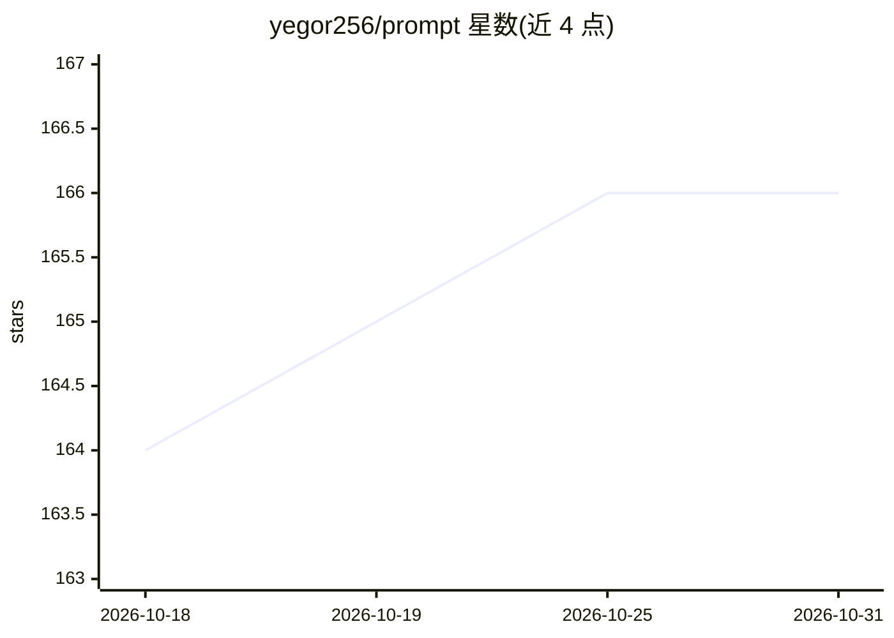

# yegor256/prompt

⭐ 166 · MIT · 推送 2026-10-30 · [GitHub](https://github.com/yegor256/prompt) · 个人维护

**纯文本系统提示词：教 LLM 遵循优雅编码与测试规范**

一份以 Markdown 纯文本写成的 LLM 系统提示词文件，内容为面向编码任务的指令集合，覆盖工具使用（GNU 工具、Git 提交/PR/issue 技能）、工作流（TDD、分支命名）、代码与对象设计规则（Elegant Objects、SOLID、DDD）、测试与测试夹具规范（一断言一测试、偏好 fake/stub 而非 mock）以及运行时约束（测试中禁用日志、假设无网络）。安装方式为将文件保存到 ~/.claude/CLAUDE.md 供 Claude 类 agent 加载。限制：无代码逻辑，仅为文本配置，规则绑定作者个人方法论（如 Angry Tests、Puzzle Driven Development）。

## 筛选速览

| 维度 | 判定 | 备注 |
|---|---|---|
| AI 角色 | `ai-ecosystem` | LLM/agent 周边工具 |
| 许可风险 | `permissive` | MIT |
| 部署形态 | `None` |  |
| 模型依赖 | — | README 未给出锁定关系 |
| 硬件要求 | — | 无带数字的原话,不猜 |
| 安装摩擦 | `low` | 无编译、无系统依赖或容器化 |
| 成熟度 | — | 结构信号不足 |

## 能力要点

- 覆盖工具、工作流、代码、对象、测试、夹具、运行时七大类编码规则指令
- 引用 Elegant Objects / SOLID / DDD / TDD 等方法论并转为具体约束
- 以纯文本 Markdown 提供，保存为 ~/.claude/CLAUDE.md 即可生效

## 适用场景

- 给 Claude 类编码 agent 配置统一的代码风格与测试纪律
- 让 LLM 助手在编码会话中遵循 TDD 与最小变更原则
- 个人或团队沉淀编码规范为可复用的系统提示词

## 场景标签

`提示工程` · 领域:Agent 开发

## 证据(README 行号)

> L25: Always practice TDD (test-driven development), reproducing bugs before fixing.
> L74: Follow "Angry Tests".
> L55: Honor Elegant Objects and SOLID (single, open, Liskov, interface, dependency).

## 星数曲线

2026-10-18 164 → 2026-10-31 166（+2）

---
*卡片 v1 · prompt 1.4 · 生成 2026-10-22 · 置信度 mid · 依据 README sha `0e5bb16efb1f` · [字段定义](../../DATASET.md)*
