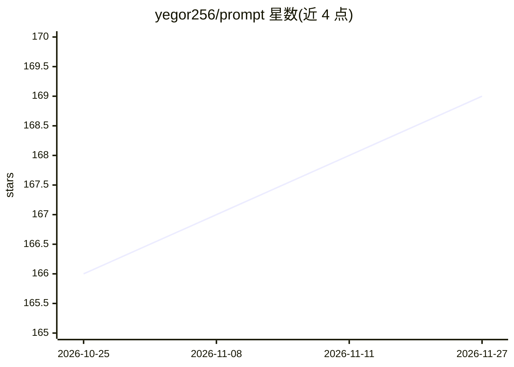

# yegor256/prompt

⭐ 169 · MIT · 推送 2026-11-26 · [GitHub](https://github.com/yegor256/prompt) · 个人维护

**给 Claude 编码代理使用的高质量编码规范纯文本提示词**

一份纯文本提示词文件，内容为编码与测试的规范指令集合，涵盖工具使用、Git 工作流（按 issue 命名分支、TDD）、代码风格（Elegant Objects、SOLID、DDD、YAGNI）、不可变对象、测试隔离与 fixtures 等条目。使用者将其保存为 ~/.claude/CLAUDE.md，供 Claude 在会话中读取并遵循。仓库本身不含可安装的软件或代码，仅提供该提示词文本。

## 筛选速览

| 维度 | 判定 | 备注 |
|---|---|---|
| AI 角色 | `ai-knowledge` | 知识聚合/清单类 |
| 许可风险 | `permissive` | MIT |
| 部署形态 | `None` |  |
| 模型依赖 | — | README 未给出锁定关系 |
| 硬件要求 | — | 无带数字的原话,不猜 |
| 安装摩擦 | `low` | 无编译、无系统依赖或容器化 |
| 成熟度 | — | 结构信号不足 |

## 能力要点

- 面向 Claude（CLAUDE.md 格式）的编码规范提示词
- 覆盖工作流、代码风格、方法设计、测试与 fixtures 等章节
- 规定 TDD、按 GitHub issue 命名分支等 Git 工作流纪律

## 适用场景

- 为 Claude Code 配置统一的编码与测试规范
- 让 AI 代理遵循 Elegant Objects/SOLID 风格写代码
- 规范 AI 辅助开发时的 TDD 与 Git 分支纪律

## 场景标签

`提示工程` · 领域:Agent 开发

## 证据(README 行号)

> L1: # Be Quality Dogmatic
> L25: Always practice TDD (test-driven development), reproducing bugs before fixing.

## 星数曲线

2026-10-25 166 → 2026-11-27 169（+3）

---
*卡片 v1 · prompt 1.4 · 生成 2026-11-26 · 置信度 high · 依据 README sha `11f333b54da9` · [字段定义](../../DATASET.md)*
