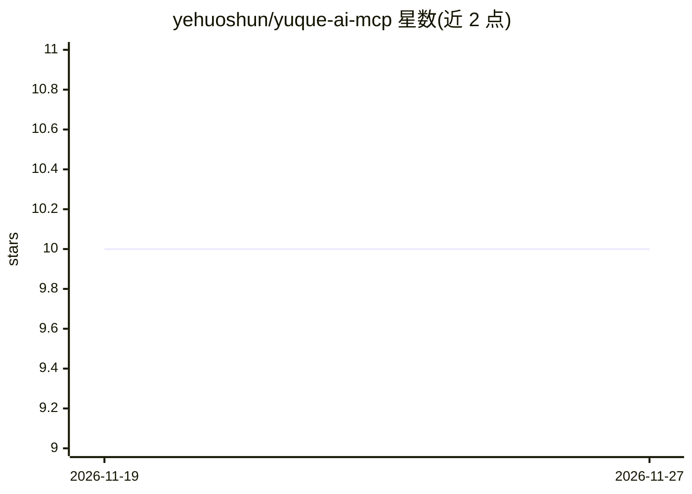

# yehuoshun/yuque-ai-mcp

⭐ 10 · TypeScript · MIT · 推送 2026-11-22 · [GitHub](https://github.com/yehuoshun/yuque-ai-mcp) · 个人维护 · 中文 README

**给 AI Agent 提供语雀全功能操作的 MCP Server**

基于 Model Context Protocol 构建的语雀 MCP 服务器，提供 65 个细粒度工具，覆盖文档 CRUD、知识库管理、目录、搜索、回收站、上传、画板、统计、小记、用户/团队管理 13 个域；其中 45 个走语雀 OpenAPI（Token 认证），20 个为 Web API 工具（需浏览器 Cookie + csrf token）。支持 stdio 与 HTTP SSE 双传输、config.json 配置、统一错误处理（429 自动重试、book_full 自动扩库），另附 67 篇面向 AI Agent 的使用指南。Node/npm 构建运行。

## 筛选速览

| 维度 | 判定 | 备注 |
|---|---|---|
| AI 角色 | `ai-ecosystem` | LLM/agent 周边工具 |
| 许可风险 | `permissive` | MIT |
| 部署形态 | `library` | 以包/库形式分发 |
| 模型依赖 | — | README 未给出锁定关系 |
| 硬件要求 | — | 无带数字的原话,不猜 |
| 安装摩擦 | `low` | 无编译、无系统依赖或容器化 |
| 成熟度 | — | 结构信号不足 |

## 能力要点

- 65 个工具覆盖 13 个域，含回收站/上传/统计/画板等官方 MCP 未覆盖的功能
- stdio + HTTP SSE 双传输，共享注册表
- OpenAPI Token 与浏览器 Cookie 双认证通道
- 附 67 篇面向 AI Agent 的技能使用指南

## 适用场景

- 让 Claude 等 MCP 客户端代为管理和编辑语雀知识库文档
- 通过 RAG 增强搜索检索语雀文档内容
- 批量导出知识库为 Markdown 并按目录结构组织
- 管理团队知识库的成员、统计与回收站

## 场景标签

 · 领域:LLM 基础设施/工具集成

## 证据(README 行号)

> L13: A full-featured Yuque (语雀) MCP Server built on the Model Context Protocol. Provides 65 fine-grained tools across 13
> L21: - **Skill layer** — 67 usage guides for AI agents
> L18: - **Dual transport** — stdio + HTTP SSE, shared registry, zero downtime on reload

## 星数曲线

2026-11-19 10 → 2026-11-27 10（+0）

---
*卡片 v1 · prompt 1.4 · 生成 2026-11-19 · 置信度 high · 依据 README sha `50073d5e4025` · [字段定义](../../DATASET.md)*
