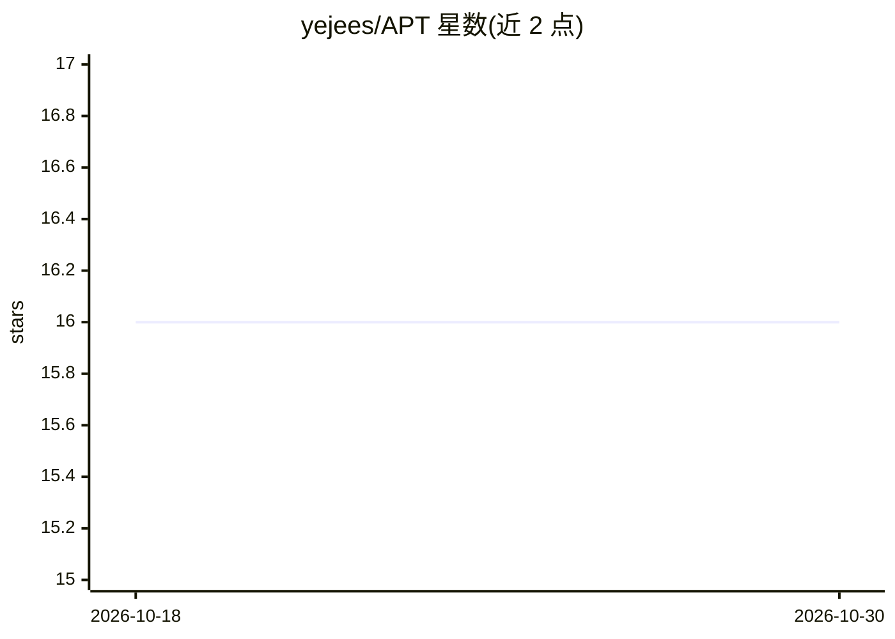

# yejees/APT

⭐ 16 · Python · MIT · 推送 2025-12-16 · [GitHub](https://github.com/yejees/APT) · 组织维护

**CVPR 2025 论文 APT 官方代码：扩散模型多对比度 MR 图像合成**

CVPR 2025 论文 Anatomical Consistency and Adaptive Prior-informed Transformation 的官方 PyTorch 实现。APT 是统一扩散模型，输入一种或多种对比度的脑 MR 图像，生成缺失对比度图像；包含互信息融合模块（MIF）、解剖一致性损失，以及两阶段推理：先经 prior codebook 提供粗解剖结构引导，再用迭代展开加权平均细化细节。提供训练（adapter 与扩散模型分开）、codebook 构建与三种推理脚本（1→3、2→2、3→1），BRATS 推理已内置预构建 codebook。面向科研复现与医学图像合成研究。

## 筛选速览

| 维度 | 判定 | 备注 |
|---|---|---|
| AI 角色 | `ai-native` | 本体是模型或模型工具 |
| 许可风险 | `permissive` | MIT |
| 部署形态 | `library` | 以包/库形式分发 |
| 模型依赖 | — | README 未给出锁定关系 |
| 硬件要求 | — | 无带数字的原话,不猜 |
| 安装摩擦 | `low` | 无编译、无系统依赖或容器化 |
| 成熟度 | — | 结构信号不足 |

## 能力要点

- 统一扩散模型生成多对比度 MR 图像（1→3、2→2、3→1 三种推理）
- 互信息融合模块（MIF）与解剖一致性损失
- 两阶段推理：prior codebook 粗引导 + 迭代展开细化
- BRATS 推理内置预构建 prior codebook

## 适用场景

- 复现 CVPR 2025 APT 论文实验
- 从已有对比度 MR 图像合成缺失对比度图像
- 基于代码改进多对比度医学图像合成方法

## 场景标签

`图像生成` `科研工具` · 领域:内容生成

## 证据(README 行号)

> L5: This repo contains the code for our paper published in CVPR 2025: **APT** .
> L9: > **Abstract:** Multi-contrast magnetic resonance (MR) images offer critical diagnostic information but are limited 

## 星数曲线

2026-10-18 16 → 2026-10-30 16（+0）

---
*卡片 v1 · prompt 1.4 · 生成 2026-10-30 · 置信度 mid · 依据 README sha `6c3041dc5f91` · [字段定义](../../DATASET.md)*
