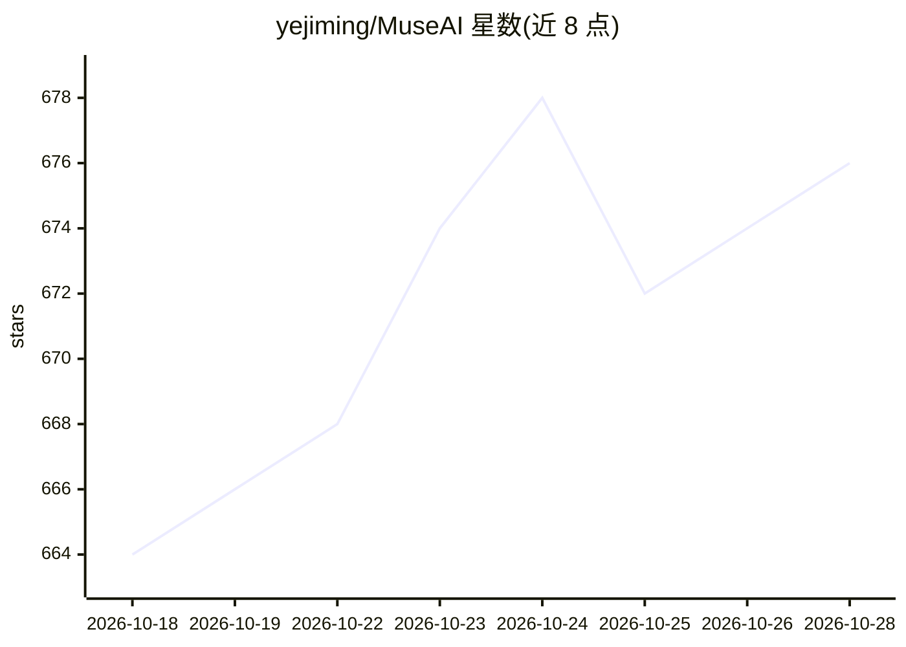

# yejiming/MuseAI

⭐ 677 · TypeScript · 推送 2026-08-14 · [GitHub](https://github.com/yejiming/MuseAI) · 个人维护 · 中文 README

**本地 AI 伴侣、文字冒险与穿书互动桌面应用**

面向沉浸式角色互动的本地桌面应用：创建世界书与角色卡后，可与 AI 角色长期聊天、进行跑团式文字冒险，或从小说大纲装配可游玩的穿书世界；对话与冒险可归档为角色记忆与羁绊档案。附带辅助创作工具：Markdown 作品管理、范文库、大纲评估/反向大纲与去 AI 味模块。模型通过用户自配的 OpenAI/Anthropic/兼容 OpenAI 格式 API Key 调用，数据存于本地 ~/Documents/MuseAI/，支持局域网手机访问，另提供 DeepSeek Harness 客户端插件。

## 筛选速览

| 维度 | 判定 | 备注 |
|---|---|---|
| AI 角色 | `ai-native` | 本体是模型或模型工具 |
| 许可风险 | `none` | — |
| 部署形态 | `desktop` | 安装包/桌面程序 |
| 模型依赖 | locked-api |  |
| 硬件要求 | — | 无带数字的原话,不猜 |
| 安装摩擦 | `low` | 无编译、无系统依赖或容器化 |
| 成熟度 | — | 结构信号不足 |

## 能力要点

- 世界书+角色卡驱动的伴侣聊天、文字冒险与穿书三种互动模式
- 归档记忆与羁绊档案：关系轨迹、时间线、会话/冒险足迹
- 从小说原文/大纲自动提取世界书与角色卡，支持长篇分布式分析
- 大纲评估/反向大纲与去 AI 味检测/去除等辅助创作模块

## 适用场景

- 创建角色与世界设定，进行长期 AI 角色聊天或扮演
- 与 AI 主持人（DM/GM）一起进行文字冒险跑团
- 把自己整理的小说装配成可进入、可改写剧情的穿书世界
- 本地管理小说素材、大纲并检测/优化 AI 生成文本

## 场景标签

`聊天机器人` `AI 写作` · 领域:对话与助手

## 证据(README 行号)

> L10: MuseAI 是一款面向沉浸式角色互动的本地 AI 应用。你可以创建自己的角色与世界设定，和角色持续对话、共同经历冒险，并在一次次互动中积累关系、记忆与羁绊。
> L208: A：MuseAI 当前更适合作为本地 AI 伴侣、AI 角色聊天、文字冒险和穿书互动应用使用。作品管理、大纲、反向大纲和去 AI 味属于辅助创作能力，用来帮助你整理故事世界和互动素材。

## 星数曲线

2026-10-18 664 → 2026-10-28 676（+12）

---
*卡片 v1 · prompt 1.4 · 生成 2026-10-21 · 置信度 high · 依据 README sha `d30f4e3ae344` · [字段定义](../../DATASET.md)*
