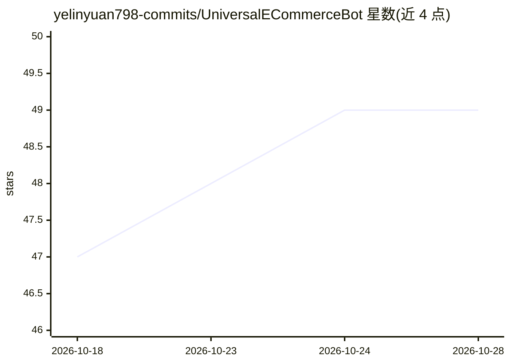

# yelinyuan798-commits/UniversalECommerceBot

⭐ 49 · Python · 推送 2026-07-13 · [GitHub](https://github.com/yelinyuan798-commits/UniversalECommerceBot) · 个人维护 · 中文 README

**多平台电商 AI 自动客服系统，自动回复/议价/发货**

用 Python 编写的电商客服自动化程序：通过 Cookie 接入电商平台账号，AI 自动回复买家消息、阶梯式自动议价、付款后自动发送网盘链接发货，并支持崩溃自动重启与 Token 刷新实现持续值守。宣称支持 10+ 平台，但 README 中仅闲鱼标注为已跑通，淘宝/拼多多/京东等均为模板就绪、API 对接中状态。面向不想写代码的中小卖家，双击 setup.bat 安装，填 API Key 与 Cookie 即可运行；新平台需开发者实现 6 个接口方法接入。

## 筛选速览

| 维度 | 判定 | 备注 |
|---|---|---|
| AI 角色 | `ai-native` | 本体是模型或模型工具 |
| 许可风险 | `none` | — |
| 部署形态 | `None` |  |
| 模型依赖 | — | README 未给出锁定关系 |
| 硬件要求 | — | 无带数字的原话,不猜 |
| 安装摩擦 | `low` | 无编译、无系统依赖或容器化 |
| 成熟度 | — | 结构信号不足 |

## 能力要点

- AI 自动回复买家消息与阶梯式自动议价
- 付款后自动匹配商品并发送网盘链接发货，带防重复记录
- 崩溃自动重启、Token 自动刷新、心跳维持的持续值守机制
- 新平台通过实现 BasePlatform 的 6 个接口方法接入

## 适用场景

- 网盘类虚拟商品卖家做 24 小时无人值守客服与自动发货
- 闲鱼店铺的自动回复和议价
- 开发者按 6 接口模板扩展其他电商平台支持

## 场景标签

`聊天机器人` `工作流自动化` · 领域:效率与自动化

## 证据(README 行号)

> L25: - 🤖 **买家发消息** → AI 自动回复（比人工快、比人工专业）
> L55:   → AI识别意图 → 生成回复 → 秒回

## 星数曲线

2026-10-18 47 → 2026-10-28 49（+2）

---
*卡片 v1 · prompt 1.4 · 生成 2026-10-24 · 置信度 mid · 依据 README sha `e52a9f428505` · [字段定义](../../DATASET.md)*
