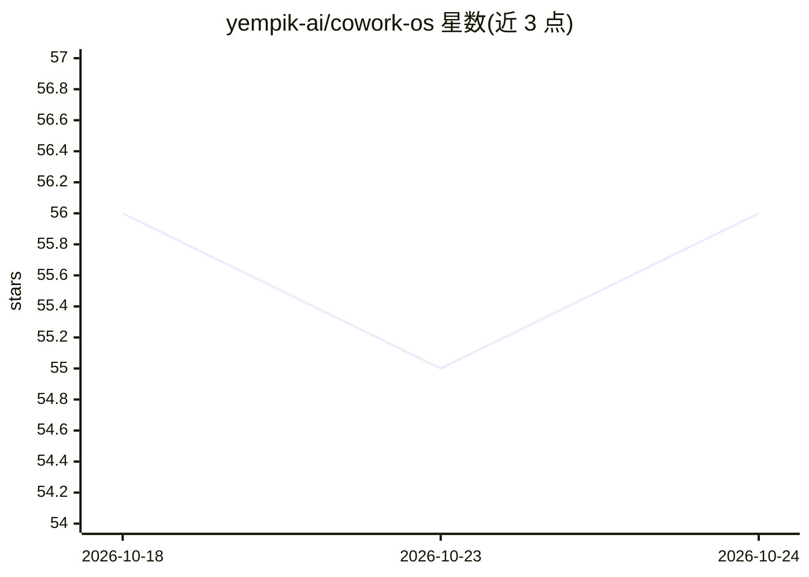

# yempik-ai/cowork-os

⭐ 55 · MIT · 推送 2026-07-16 · [GitHub](https://github.com/yempik-ai/cowork-os) · [官网](https://www.yempik.com/cowork-os) · 组织维护

**面向 Claude Cowork 的 Markdown 团队工作区结构：决策、上下文与例行任务**

cowork-os 是一个开源（MIT）的工作区/流程模板层，供 Claude Cowork 及其他可读取文件的 AI agent 加载使用：以纯 Markdown 维护决策、待定问题、项目状态、下一步行动与循环例程，配合 Project Instructions 约束 agent 行为（核查来源、区分事实与假设、任务结束回写状态）。附 Knowledge Transfer 访谈、Decision Radar、LinkedIn Growth OS、Pipeline 等 14 个定时任务模板。非独立应用、无依赖、无运行时，通过插件安装、复制文件夹或手动填充三种方式部署。

## 筛选速览

| 维度 | 判定 | 备注 |
|---|---|---|
| AI 角色 | `ai-ecosystem` | LLM/agent 周边工具 |
| 许可风险 | `permissive` | MIT |
| 部署形态 | `None` |  |
| 模型依赖 | locked-api |  |
| 硬件要求 | — | 无带数字的原话,不猜 |
| 安装摩擦 | `low` | 无编译、无系统依赖或容器化 |
| 成熟度 | — | 结构信号不足 |

## 能力要点

- Markdown 操作上下文 + 工作状态回写协议，agent 行动前读取、结束回写
- Knowledge Transfer 访谈将成员隐性知识写入工作区
- 14 个定时任务模板（每日简报、信号扫描、决策雷达等）
- 插件一条命令安装并由 Claude 访谈式生成预配置工作区

## 适用场景

- 团队用文件承载 AI 工作所需决策与上下文，可读可改可治理
- 把例行运营（营销巡检、决策追踪）交给 agent 定时执行
- 通过访谈沉淀离职风险中的隐性流程知识

## 场景标签

`知识库管理` `工作流自动化` · 领域:效率与自动化

## 证据(README 行号)

> L30: `cowork-os` is an open-source company brain workspace for Claude Cowork and file-reading AI agents, created by Yemp
> L44: There is no separate runtime or backend. The agent is Claude Cowork itself. cowork-os is what you load into the pro
> L51: The "multiple agents" are separate runs and sub-agents that coordinate through the shared files, not a fleet of ser

## 星数曲线

2026-10-18 56 → 2026-10-24 56（+0）

---
*卡片 v1 · prompt 1.4 · 生成 2026-10-24 · 置信度 high · 依据 README sha `da9940001a01` · [字段定义](../../DATASET.md)*
