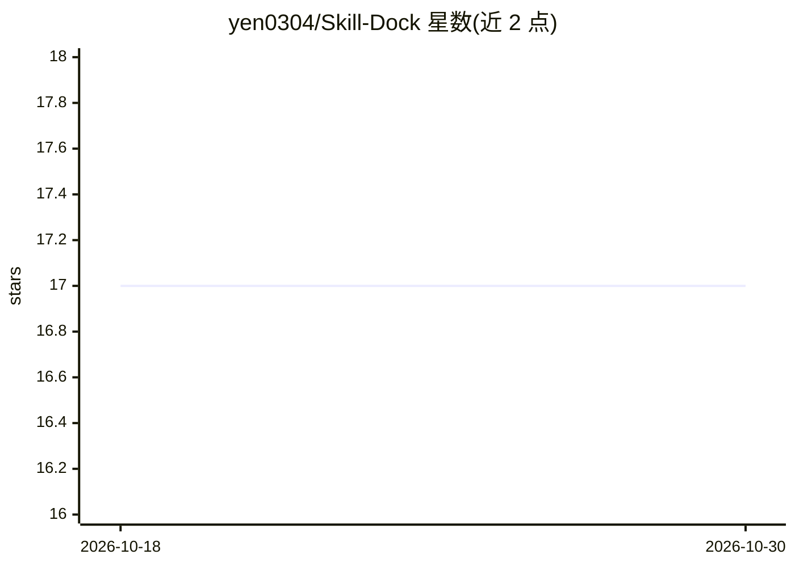

# yen0304/Skill-Dock

⭐ 17 · TypeScript · MIT · 推送 2026-06-09 · [GitHub](https://github.com/yen0304/Skill-Dock) · 个人维护 · 中文 README

**本地优先的 VS Code/Cursor agent 技能管理扩展**

VS Code / Cursor 扩展，用于在本地（默认 ~/.skilldock/skills/）创建、编辑、搜索、复制和删除 agent 技能，并从 GitHub 仓库的技能市场浏览与一键安装技能（含 skills.sh 生态搜索）。支持将库中技能按 20 余种格式（Claude、Cursor、Codex、Copilot、Windsurf、Cline 等）导入到当前项目的对应目录，也支持反向保存仓库技能入库。技能采用 SKILL.md 与 YAML frontmatter 约定，GitHub Token 存于 VS Code 加密 SecretStorage。

## 筛选速览

| 维度 | 判定 | 备注 |
|---|---|---|
| AI 角色 | `ai-ecosystem` | LLM/agent 周边工具 |
| 许可风险 | `permissive` | MIT |
| 部署形态 | `library` | 以包/库形式分发 |
| 模型依赖 | — | README 未给出锁定关系 |
| 硬件要求 | — | 无带数字的原话,不猜 |
| 安装摩擦 | `low` | 无编译、无系统依赖或容器化 |
| 成熟度 | — | 结构信号不足 |

## 能力要点

- 本地技能库的完整 CRUD 与表单化技能编辑器
- 从 GitHub 仓库市场与 skills.sh 注册表一键安装技能
- 支持 20 余种 agent 格式的多选导入与反向保存
- GitHub Token 存储于 VS Code 加密 SecretStorage（限流提升至 5000 次/小时）

## 适用场景

- 在本地统一管理并复用各项目的 agent 技能
- 从 Anthropic、OpenAI 等技能仓库浏览并安装技能
- 把技能按目标 agent 目录格式导入当前工作区

## 场景标签

`提示工程` · 领域:Agent 开发

## 证据(README 行号)

> L12: Browse, create, edit, delete, and import agent skills across any project — supporting multiple AI assistant formats
> L59: Import skills from your library into the current workspace. Choose the target format:

## 星数曲线

2026-10-18 17 → 2026-10-30 17（+0）

---
*卡片 v1 · prompt 1.4 · 生成 2026-10-29 · 置信度 mid · 依据 README sha `d6b4ff4e8aa6` · [字段定义](../../DATASET.md)*
