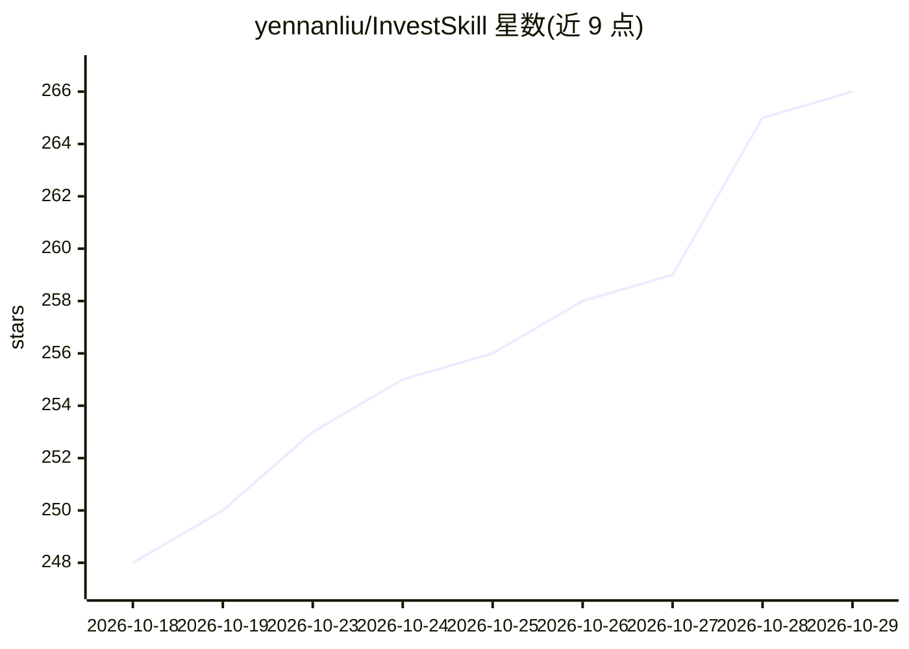

# yennanliu/InvestSkill

⭐ 266 · JavaScript · MIT · 推送 2026-10-24 · [GitHub](https://github.com/yennanliu/InvestSkill) · [官网](http://yennj12.js.org/InvestSkill/) · 个人维护 · 中文 README

**30 个美股分析提示词框架，接入任意 AI 助手产出机构级投资分析**

一组面向美股投资分析的 Markdown 提示词技能集合（30 个框架），不含运行时：通过安装脚本或 Claude Code 插件市场接入 Claude Code、Cursor、Gemini CLI、Copilot、ChatGPT 或本地 Ollama 等助手，由 AI 读取公开财报与免费数据源产出 Piotroski 评分、估值、期权分析、风险压力测试等结果，并附 HTML 报告生成与逐条事实核验技能。无需 API key 与订阅，MIT 许可，附英文与繁体中文的十三课投资学习指南。

## 筛选速览

| 维度 | 判定 | 备注 |
|---|---|---|
| AI 角色 | `ai-ecosystem` | LLM/agent 周边工具 |
| 许可风险 | `permissive` | MIT |
| 部署形态 | `None` |  |
| 模型依赖 | locked-api |  |
| 硬件要求 | — | 无带数字的原话,不猜 |
| 安装摩擦 | `low` | 无编译、无系统依赖或容器化 |
| 成熟度 | — | 结构信号不足 |

## 能力要点

- 30 个结构化分析框架覆盖估值、财报、市场监测、高级研究与报告输出
- 无 API key/无订阅，技能为纯 Markdown 提示词，无运行时代码
- 安装脚本适配 Claude Code / Cursor / Gemini CLI / Codex / OpenCode 等多种 agent 入口
- 内置 SEC EDGAR 无密钥取数配方与 claim 级事实核验技能

## 适用场景

- 让 Claude Code / Cursor / Gemini CLI 等助手执行标准化个股评估与估值
- 生成含技术面与基本面信号的投资研究报告
- 对已有分析报告做逐条数据核验与打分

## 场景标签

`提示工程` `金融量化` · 领域:Agent 开发

## 证据(README 行号)

> L17: InvestSkill is a collection of **30 structured analysis frameworks** that turn any AI assistant into an institution
> L48: |`claude`|Claude Code|`.claude/skills/<skill>/SKILL.md` (slash commands)|

## 星数曲线

2026-10-18 248 → 2026-10-29 266（+18）

---
*卡片 v1 · prompt 1.4 · 生成 2026-10-22 · 置信度 high · 依据 README sha `d8a21f71d962` · [字段定义](../../DATASET.md)*
