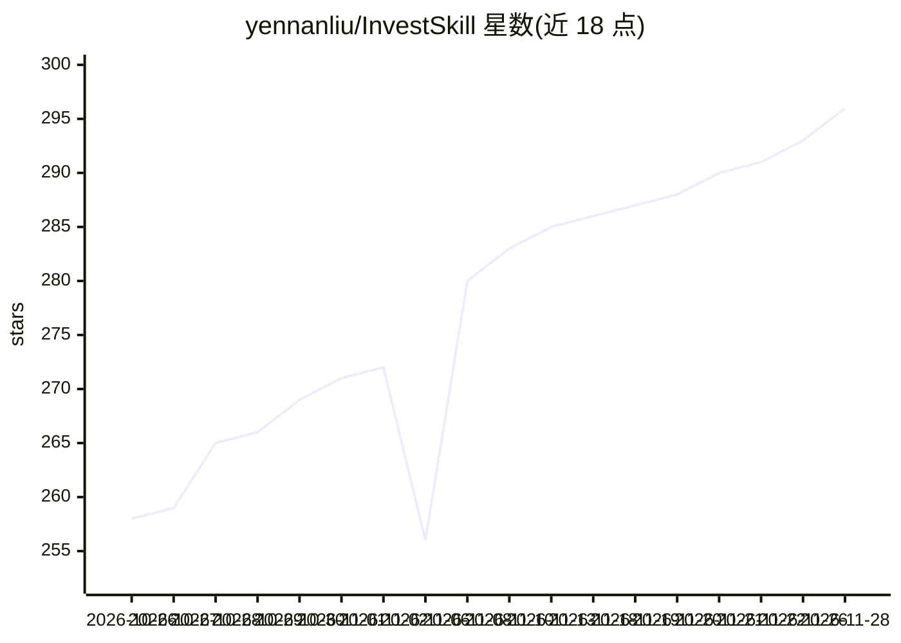

# yennanliu/InvestSkill

⭐ 296 · JavaScript · MIT · 推送 2026-11-15 · [GitHub](https://github.com/yennanliu/InvestSkill) · [官网](http://yennj12.js.org/InvestSkill/) · 个人维护 · 中文 README

**为 LLM 助手提供 34 个美股投资分析框架提示词集**

以纯 Markdown 提示词形式分发的 34 个美股分析框架集合，无运行时、无代码调用，覆盖估值、财报解读、舞弊识别、市场监控、组合风险、税务与交易复盘等，输出如 Piotroski 分数、买卖信号、风险评分。安装脚本可将框架写入 Claude Code、Cursor、Copilot、Gemini CLI 等工具的指令入口，也可克隆仓库后手动粘贴使用；支持繁体中文输出。数据分析依赖助手读取公开文件或用户粘贴数据，不含付费数据源。

## 筛选速览

| 维度 | 判定 | 备注 |
|---|---|---|
| AI 角色 | `ai-knowledge` | 知识聚合/清单类 |
| 许可风险 | `permissive` | MIT |
| 部署形态 | `None` |  |
| 模型依赖 | local-ok | 支持本地模型 |
| 硬件要求 | — | 无带数字的原话,不猜 |
| 安装摩擦 | `low` | 无编译、无系统依赖或容器化 |
| 成熟度 | — | 结构信号不足 |

## 能力要点

- 34 个结构化分析框架，全部为 Markdown 提示词，无运行时
- 提供安装脚本接入 Claude Code/Cursor/Copilot/Gemini CLI/Codex 等 agent 入口
- 支持 --lang zh-TW 输出繁体中文，含繁体学习教程
- 无 API key、无订阅、无遥测，可搭配本地模型（Ollama）使用

## 适用场景

- 用现有 AI 助手对美股做估值与质量评分
- 解读 10-K/财报电话会并核查会计红旗
- 组合再平衡、税损收割与风险压力测试
- 投资新手按 15 课教程学习财报与估值概念

## 场景标签

`金融量化` `教程课程` · 领域:学习与行业

## 证据(README 行号)

> L17: InvestSkill is a collection of **34 structured analysis frameworks** that turn any AI assistant into an institution
> L85: |**Install / runtime**|**None.** Every skill is a plain markdown prompt. Nothing runs on your machine, so nothing p
> L92: **In Traditional Chinese, too.** Add `--lang zh-TW` to any framework and the whole analysis comes back in 繁體中文 — he

## 星数曲线

2026-10-26 258 → 2026-11-28 296（+38）

---
*卡片 v1 · prompt 1.4 · 生成 2026-11-25 · 置信度 high · 依据 README sha `4d271c1b31bd` · [字段定义](../../DATASET.md)*
