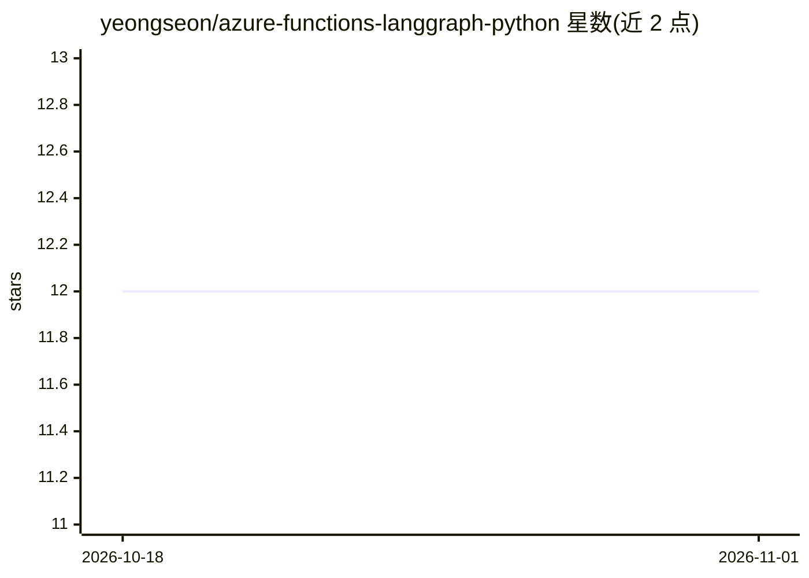

# yeongseon/azure-functions-langgraph-python

⭐ 12 · Python · MIT · 推送 2026-10-31 · [GitHub](https://github.com/yeongseon/azure-functions-langgraph-python) · [官网](https://yeongseon.dev/azure-functions-python/langgraph/) · 个人维护

**将已编译的 LangGraph 图部署为 Azure Functions HTTP 端点的适配器**

面向 Python 开发者的部署适配器：把已有的 LangGraph 图包装为 Azure Functions Python v2 的 HTTP 端点（invoke/stream/state），无需自行编写请求处理代码。提供 LangGraphApp 构建接口，支持 Python 3.11–3.14；稳定性按接口分层（Stable/Beta/Experimental），经典流式路由返回缓冲 SSE 而非增量 token，进程级锁在分布式部署下需自行提供存储/锁。属独立社区项目，与 Microsoft 或 LangChain 无隶属关系，MIT 许可。

## 筛选速览

| 维度 | 判定 | 备注 |
|---|---|---|
| AI 角色 | `ai-ecosystem` | LLM/agent 周边工具 |
| 许可风险 | `permissive` | MIT |
| 部署形态 | `library` | 以包/库形式分发 |
| 模型依赖 | locked-api |  |
| 硬件要求 | — | 无带数字的原话,不猜 |
| 安装摩擦 | `low` | 无编译、无系统依赖或容器化 |
| 成熟度 | `idea` | |

## 能力要点

- 把已编译 LangGraph 图暴露为 Azure Functions HTTP 端点（invoke/stream/state）
- 按接口分层声明稳定性（Stable/Beta/Experimental）
- 示例支持无云凭据的确定性假模型
- 部署路由默认要求 function key

## 适用场景

- 把现有 LangGraph agent 部署到 Azure Functions 无服务器环境
- 以 HTTP API 形式对外提供 LangGraph 图的调用与状态查询
- 用假模型在本地确定性测试 agent 流程

## 场景标签

 · 领域:LLM 基础设施/无服务器部署

## 证据(README 行号)

> L3: Deploy existing LangGraph graphs as
> L4: Azure Functions Python v2 HTTP endpoints without writing request wrappers.
> L84: this package owns serving compiled graphs, not prompts, models or tool frameworks.

## 星数曲线

2026-10-18 12 → 2026-11-01 12（+0）

---
*卡片 v1 · prompt 1.4 · 生成 2026-10-31 · 置信度 high · 依据 README sha `6d3918523887` · [字段定义](../../DATASET.md)*
