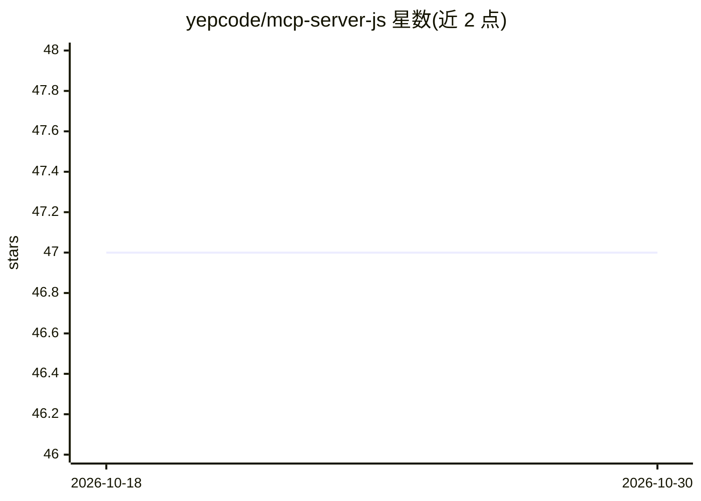

# yepcode/mcp-server-js

⭐ 47 · TypeScript · MIT · 推送 2026-03-17 · [GitHub](https://github.com/yepcode/mcp-server-js) · [官网](https://yepcode.io/mcp-server) · 组织维护

**把 YepCode 流程暴露为 MCP 工具的服务器，供 AI 助手调用**

由 YepCode 团队维护的 MCP（Model Context Protocol）服务器：将 YepCode 云端流程作为 AI 助手可直接调用的工具，支持以 JSON Schema 定义工具参数、用 Python 或 Node.js 实现工具（可混用多种语言）。内置代码执行、环境变量、文件存储、流程/调度/执行/模块管理等 API 工具，通过 YEPCODE_MCP_TOOLS 环境变量按标签选择暴露哪些工具。可经 NPX 本地运行、Docker 构建或使用官方托管服务，需 YepCode API 凭据。

## 筛选速览

| 维度 | 判定 | 备注 |
|---|---|---|
| AI 角色 | `ai-ecosystem` | LLM/agent 周边工具 |
| 许可风险 | `permissive` | MIT |
| 部署形态 | `self-host` | docker 或自建部署 |
| 模型依赖 | — | README 未给出锁定关系 |
| 硬件要求 | — | 无带数字的原话,不猜 |
| 安装摩擦 | `low` | 无编译、无系统依赖或容器化 |
| 成熟度 | — | 结构信号不足 |

## 能力要点

- 每个 YepCode 流程可按标签暴露为独立 MCP 工具
- 工具参数以 JSON Schema 定义，Python/Node.js 混合实现
- 内置代码执行、存储管理、流程/调度/执行/模块 API 工具
- 提供 NPX 本地运行、Docker 构建与云端托管三种方式

## 适用场景

- 让 Cursor、Claude Desktop 等 AI 平台直接调用我的自动化流程
- 把内部 API 与脚本封装成 AI 可调用的工具
- 在隔离环境中执行 LLM 生成的代码

## 场景标签

`工作流自动化` · 领域:效率与自动化

## 证据(README 行号)

> L12: An MCP (Model Context Protocol) server that enables AI platforms to interact with YepCode's infrastructure. Run LLM
> L35: This package lets you run the YepCode MCP server **locally** or in your own infrastructure (NPX, Docker, or custom 

## 星数曲线

2026-10-18 47 → 2026-10-30 47（+0）

---
*卡片 v1 · prompt 1.4 · 生成 2026-10-25 · 置信度 high · 依据 README sha `f00693e2ee38` · [字段定义](../../DATASET.md)*
