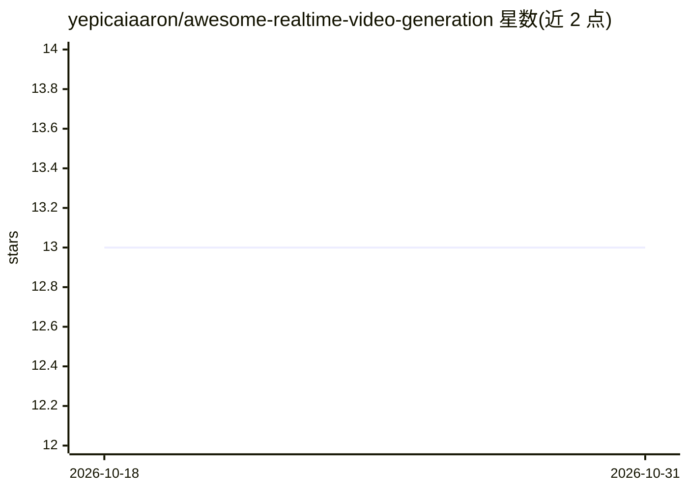

# yepicaiaaron/awesome-realtime-video-generation

⭐ 13 · MIT · 推送 2026-04-15 · [GitHub](https://github.com/yepicaiaaron/awesome-realtime-video-generation) · 个人维护

**面向生产部署的实时视频生成模型策展清单**

一个 Awesome 类策展清单，收录实时与近实时视频生成模型，按真实流式（TTFF/FPS）与快速批量两类排行榜组织，收录标准为端到端延迟支持交互式场景（如短片段低于 5 秒）。条目给出开发者、硬件、架构、延迟、部署方式与链接，覆盖通用视频生成、数字人/说话头像等类别，面向生产工程师、推理优化研究者与评估部署可行性的开发者。清单本身不含可运行代码，部分条目标注 Code/Paper coming soon。

## 筛选速览

| 维度 | 判定 | 备注 |
|---|---|---|
| AI 角色 | `ai-knowledge` | 知识聚合/清单类 |
| 许可风险 | `permissive` | MIT |
| 部署形态 | `self-host` | docker 或自建部署 |
| 模型依赖 | — | README 未给出锁定关系 |
| 硬件要求 | — | 无带数字的原话,不猜 |
| 安装摩擦 | `low` | 无编译、无系统依赖或容器化 |
| 成熟度 | — | 结构信号不足 |

## 能力要点

- 按 TTFF/FPS/硬件/状态组织的实时模型排行榜
- 收录标准明确：延迟需支持交互式用例
- 条目含开发者、架构、硬件、部署途径等信息

## 适用场景

- 为视频应用选型可实时运行的生成模型
- 对比各模型的硬件需求与延迟指标
- 按生产/研究状态筛选可部署的模型

## 场景标签

`视频生成` `精选清单` · 领域:内容生成

## 证据(README 行号)

> L9: A curated list of **real-time and near real-time video generation models** focused on production deployment and low-
> L15: Most video generation research prioritizes quality over speed. This repo focuses on the inverse: **models fast enou

## 星数曲线

2026-10-18 13 → 2026-10-31 13（+0）

---
*卡片 v1 · prompt 1.4 · 生成 2026-10-31 · 置信度 mid · 依据 README sha `7f922b1b5e7e` · [字段定义](../../DATASET.md)*
