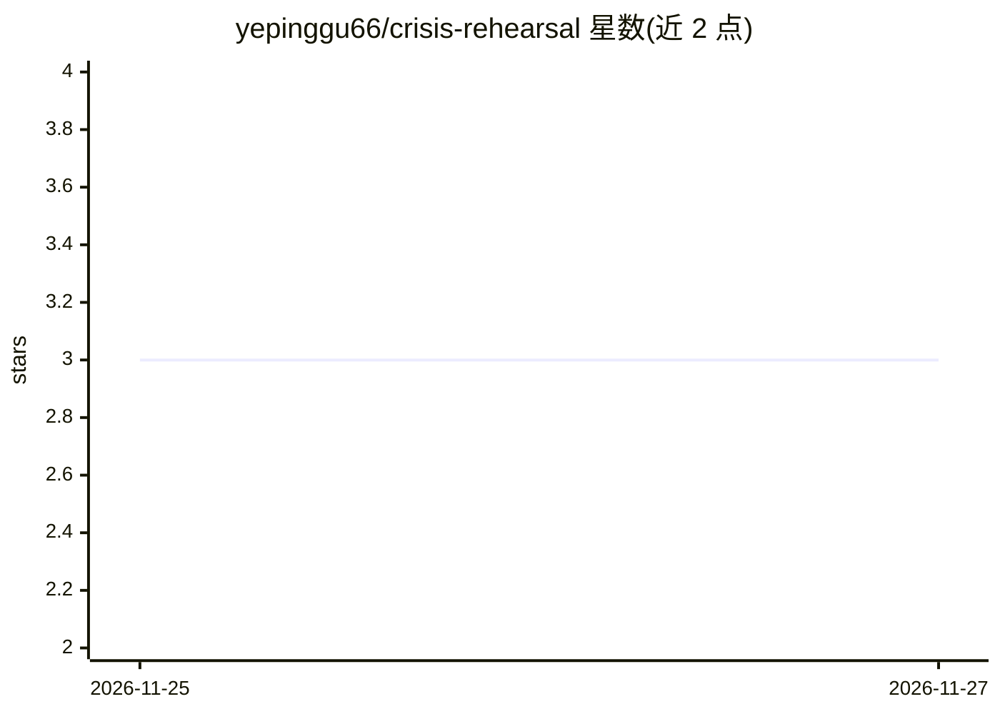

# yepinggu66/crisis-rehearsal

⭐ 3 · Python · AGPL-3.0 · 推送 2026-11-26 · [GitHub](https://github.com/yepinggu66/crisis-rehearsal) · [官网](https://weixiayu.com/) · 个人维护 · 中文 README

**危机推演工具：在事件前 72 小时以群体模拟演练声誉危机**

将真实声誉危机回溯至 T−72h，仅用当时公开信息构建 clean-room 种子，运行 7–12 个角色 agent（记者、投资者、监管者等）在模拟社交信息流上交互，生成约 8k 字演练报告并列出 Top-3 风险，再由固定 LLM judge 对照实际结果打分；附带 30 个中国公共危机事件 × 3 次运行的回测证据包，支持离线重算与哈希校验。面向企业与政府的声誉风险管理/舆情推演场景，提供 CLI 与自包含 HTML 档案。商用引擎为私有闭源，政府场景仅为设计说明。

## 筛选速览

| 维度 | 判定 | 备注 |
|---|---|---|
| AI 角色 | `ai-native` | 本体是模型或模型工具 |
| 许可风险 | `dual` | AGPL-3.0 |
| 部署形态 | `library` | 以包/库形式分发 |
| 模型依赖 | local-ok | 支持本地模型 |
| 硬件要求 | — | 无带数字的原话,不猜 |
| 安装摩擦 | `low` | 无编译、无系统依赖或容器化 |
| 成熟度 | — | 结构信号不足 |

## 能力要点

- 30 事件 × 3 次运行的公开回测证据，可离线重算并 sha256 校验
- T−72h clean-room 信息包设计，排除事后信息
- 7–12 个角色 agent 的群体模拟，DeepSeek 或任意 OpenAI 兼容模型驱动
- 零 API key 的离线 CLI（demo/stats/verify/report/site）

## 适用场景

- 企业在声誉危机爆发前做 72 小时桌面推演
- 政务舆情与应急场景的分级推演（设计说明阶段）
- 复现与审计已发布的回测统计数字

## 场景标签

`多智能体` `模型评测` · 领域:Agent 开发

## 证据(README 行号)

> L46: 3. **Swarm simulation** — 7–12 persona agents (journalists, investors, regulators, short sellers, competitors) reac
> L83: Three shapes — offline evidence workstation, private cloud, air-gap — with model choices (DeepSeek API / Ollama / v
> L5: Crisis Rehearsal rewinds a real reputation crisis to T−72h, gives a swarm-simulation engine only what was publicly k

## 星数曲线

2026-11-25 3 → 2026-11-27 3（+0）

---
*卡片 v1 · prompt 1.4 · 生成 2026-11-24 · 置信度 high · 依据 README sha `4f382fe0bf46` · [字段定义](../../DATASET.md)*
