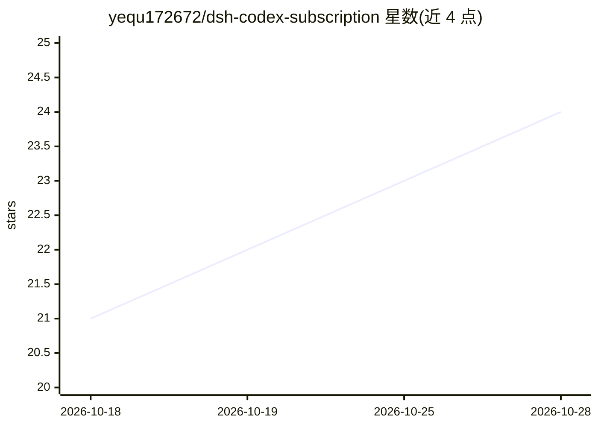

# yequ172672/dsh-codex-subscription

⭐ 24 · JavaScript · 推送 2026-10-07 · [GitHub](https://github.com/yequ172672/dsh-codex-subscription) · 个人维护 · 中文 README

**DSH 插件：复用 Codex CLI 登录凭证在 DSH 中使用 ChatGPT 订阅模型**

面向 DeepSeek Harness（DSH）用户的 LLM 适配器插件：读取 Codex CLI 登录后写入 ~/.codex/auth.json 的 OAuth 令牌，通过 ChatGPT 订阅端点调用 gpt-6.1-sol 等模型，无需 API Key。机制包括凭证热跟随（每次请求重读 auth.json）、refresh_token 自动刷新并默认写回、实时模型目录拉取（带回退缓存）、OpenAI Responses API SSE 流式映射。限制：仅文本（图片被拒）、依赖版本门控（clientVersion 需 ≥0.160.1 才能取全量目录）、国内网络需配置代理。通过 dsh plugin 命令安装后自动激活。

## 筛选速览

| 维度 | 判定 | 备注 |
|---|---|---|
| AI 角色 | `ai-ecosystem` | LLM/agent 周边工具 |
| 许可风险 | `none` | — |
| 部署形态 | `library` | 以包/库形式分发 |
| 模型依赖 | — | README 未给出锁定关系 |
| 硬件要求 | — | 无带数字的原话,不猜 |
| 安装摩擦 | `low` | 无编译、无系统依赖或容器化 |
| 成熟度 | — | 结构信号不足 |

## 能力要点

- 复用 Codex CLI 本地 OAuth 凭证，无需 API Key
- 凭证热跟随与 refresh_token 自动刷新（默认写回 auth.json）
- 模型目录实时拉取，失败时回退缓存与内置静态列表
- 0.2.x 通过 Config 字段自动生成设置页表单，热生效

## 适用场景

- 已有 ChatGPT 订阅的用户想在 DSH 里直接用订阅模型对话
- 在 DSH 中无缝使用 Codex 订阅模型并配合会话历史导入插件续聊
- 国内网络下通过 proxy 配置经代理访问 ChatGPT 后端

## 场景标签

`模型网关` · 领域:Agent 开发

## 证据(README 行号)

> L7: DSH(DeepSeek Harness)LLM 适配器插件:**直接复用 Codex CLI 的本地登录凭证**,在 DSH 中
> L8: 使用 ChatGPT 订阅模型(gpt-6.1-sol 等),不需要 API Key。
> L78: 1. **已安装 dsh 本体**(本插件是 dsh 的 profile 层,必须先有 dsh):

## 星数曲线

2026-10-18 21 → 2026-10-28 24（+3）

---
*卡片 v1 · prompt 1.4 · 生成 2026-10-27 · 置信度 high · 依据 README sha `426762d071d1` · [字段定义](../../DATASET.md)*
