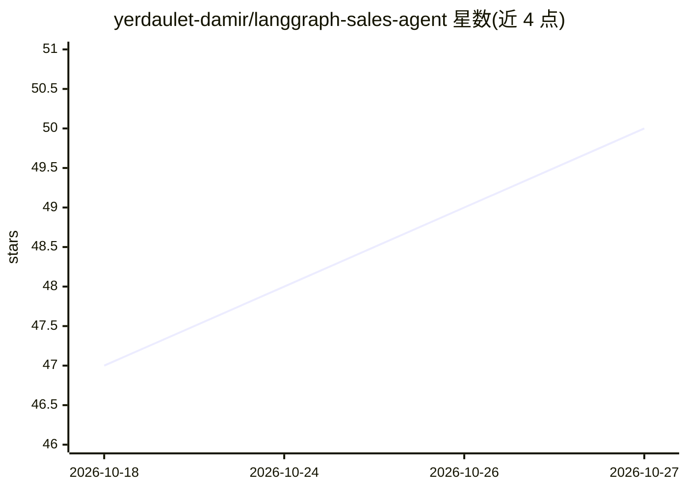

# yerdaulet-damir/langgraph-sales-agent

⭐ 50 · Python · MIT · 推送 2026-03-02 · [GitHub](https://github.com/yerdaulet-damir/langgraph-sales-agent) · 个人维护

**多租户 AI 销售代理框架：单部署服务多商家多渠道**

基于 LangGraph 的开源多租户销售代理框架：共享一个 LangGraph 图驱动所有租户代理，每个业务通过 /tenants/ 下的 config.yaml 与 products.json 注入人设、工具、目录与 LLM 配置，新增商家无需改代码。内置 CLI、FastAPI Web、Telegram、Instagram DM、WhatsApp Business 五类渠道适配器，支持按租户切换 OpenAI/Anthropic 模型，集成 LangSmith 追踪与可视化产品搜索。面向为多商家部署 AI 销售客服的开发者，克隆仓库后 pip install -e . 安装并配置 API key 运行。

## 筛选速览

| 维度 | 判定 | 备注 |
|---|---|---|
| AI 角色 | `ai-ecosystem` | LLM/agent 周边工具 |
| 许可风险 | `permissive` | MIT |
| 部署形态 | `library` | 以包/库形式分发 |
| 模型依赖 | locked-api |  |
| 硬件要求 | — | 无带数字的原话,不猜 |
| 安装摩擦 | `low` | 无编译、无系统依赖或容器化 |
| 成熟度 | — | 结构信号不足 |

## 能力要点

- 共享 LangGraph 图 + 租户 YAML 配置实现多租户隔离（人设/目录/工具/LLM）
- 内置 Telegram / Instagram / WhatsApp / Web / CLI 渠道适配器
- 按租户切换 LLM（OpenAI / Anthropic）
- LangSmith 追踪开箱即用，LangGraph Studio 可视化调试

## 适用场景

- 用一个代码库同时为花店、餐厅、电商等多个商家部署销售代理
- 把 AI 销售客服同时接入 Telegram、WhatsApp 与自家 Web 应用
- 通过放置配置文件夹快速接入新租户业务

## 场景标签

`Agent 框架` · 领域:Agent 开发

## 证据(README 行号)

> L3: **Multi-tenant AI sales agent framework powered by LangGraph**
> L15: A production-ready, open-source framework for building **AI sales agents that serve multiple businesses** from a si
> L44: The core is a **shared LangGraph graph** that drives every tenant's agent. Tenant YAML configs inject the personali
> L178: |Agent framework|LangGraph 0.4+|

## 星数曲线

2026-10-18 47 → 2026-10-27 50（+3）

---
*卡片 v1 · prompt 1.4 · 生成 2026-10-25 · 置信度 high · 依据 README sha `92df822cc343` · [字段定义](../../DATASET.md)*
